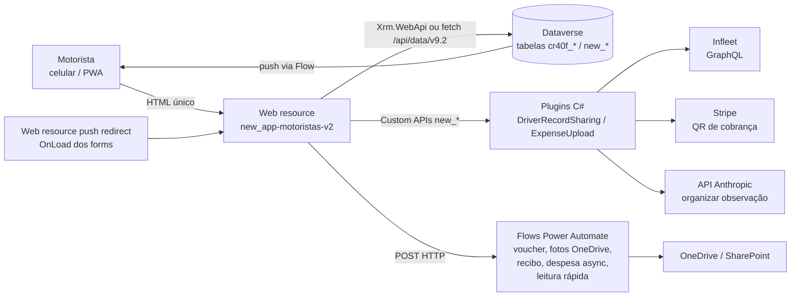
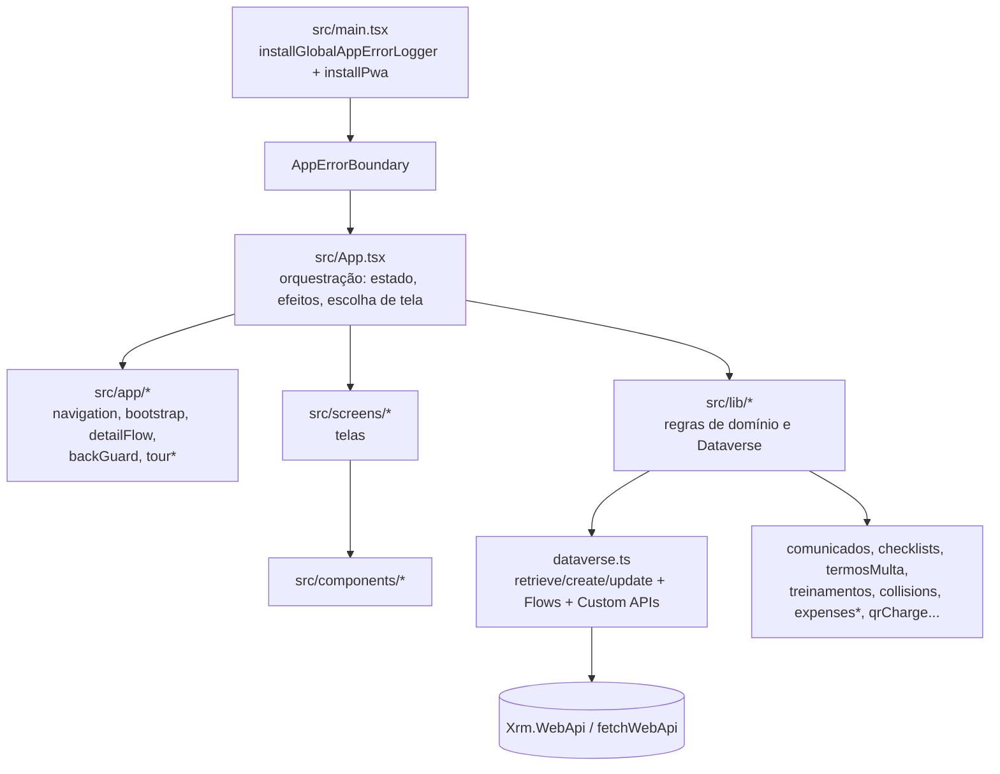

# 01. Visão geral e arquitetura

> Gerado em 03/11/2026 a partir do código da branch `docs/auto-app-motoristas` (versão `package.json` 2.1.814). Tudo aqui foi lido no código; o que não tem evidência está marcado **não confirmado**.

## O que é

App Motoristas é uma SPA React 18 + TypeScript publicada como **um único arquivo HTML** (web resource `new_app-motoristas-v2`) dentro do Dataverse/Power Platform da Betinhos Executive Service. O motorista abre o app (pelo Power Apps/model-driven, ou pela URL direta `*.dynamics.com`, inclusive instalado como PWA) e vê agenda de serviços, manutenções e trocas de carro, finaliza serviços (recebimento, voucher), registra gastos, colisões, pede manutenção, assina comunicados/termos de multa, faz treinamentos e checklists de vistoria.

Backend: tudo no Dataverse (tabelas `cr40f_*` e `new_*`), mais **plugins C#** (`plugins/`), **Custom APIs**, **Flows HTTP** do Power Automate e web resources auxiliares. Não existe servidor próprio.

## Stack (confirmado em `package.json` e `scripts/build-react-singlefile.cjs`)

| Camada | Tecnologia |
|---|---|
| UI | React 18.3, `lucide-react`, `motion`, CSS próprio (`src/styles.css` + `checklists.css`, `comunicados.css`, `termos.css`, `tour.css`, `treinamentos.css`) |
| PDF/QR | `pdf-lib` (recibo), `qrcode-generator` |
| Logger de erros | `@betinhos-executive-service/ui` (GitHub Packages) gravando em `new_appmotoristaslog` |
| Build de publicação | `esbuild` (script `build-react-singlefile.cjs`: bundle IIFE + CSS inline em um HTML) |
| Build alternativo | Vite 5 (`vite.config.ts`, plugin React); não é usado pelos scripts `build`/`dev` do `package.json` |
| Testes | `node --test --experimental-strip-types tests/*.test.ts` (56 arquivos em `tests/`) |
| Plugins | C# `net462`, `Microsoft.CrmSdk.CoreAssemblies 9.0.2.59` (assembly `Betinhos.DriverRecordSharing`) e `Betinhos.ExpenseUpload` |
| Scripts de publicação | PowerShell (`pac` CLI, MSAL.PS, Web API do Dataverse) |

Observação: `esbuild` não está em `dependencies`/`devDependencies`; chega transitivamente pelo Vite (o `package-lock.json` traz `@esbuild/*` 0.21.5). **Não confirmado** se isso é intencional.

## Diagrama de contexto

## Arquitetura interna do front

Pontos de arquitetura confirmados no código:

- **Roteamento próprio por estado** (`useState<Screen>` em `App.tsx`, tipo `Screen` em `src/types.ts`), com espelho em hash (`src/app/navigation.ts`, `SCREEN_HASH_PATHS`). Não há React Router.
- **Três runtimes** detectados em `src/lib/dataverse.ts`: (1) `Xrm.WebApi` na janela ou no `parent` (Power Apps/model-driven); (2) URL direta do web resource em `*.dynamics.com`, sem Xrm, usando `createFetchWebApi` (fetch com cookie de sessão + `WhoAmI`); (3) `localhost` sem Xrm = **modo mock** (motorista `localhost-driver`, dados de `src/data/mockData.ts`, mocks de QR, leitura rápida, comunicados, termos etc.).
- **Identidade do motorista** = e-mail Microsoft do usuário logado casado com `cr40f_funcionarios.cr40f_emailmicrosoft` (`getDriverContext`). Mais de um funcionário ativo com o mesmo e-mail é erro explícito.
- **Autorização** não é feita no front: depende de papéis de segurança, compartilhamento de registros feito por plugin (`ServiceDriverSharePlugin`) e das Custom APIs, que revalidam o dono.
- **Upload assíncrono de comprovantes de despesa** (modo `async`) só é ativado por configuração (variável de ambiente do Flow + colunas do anexo), nunca pela URL do ambiente; sem isso cai no modo `legacy` (`src/lib/expenseUploadMode.ts`).
- **Versão de build**: `scripts/build-react-singlefile.cjs` incrementa o PATCH de `package.json`/`package-lock.json` a cada build (exceto com `--no-version`) e embute `window.__APP_BUILD_INFO` (versão + data/hora America/Sao_Paulo); `src/components/layout/BuildStamp.tsx` exibe no canto.
- **Persistência local**: `localStorage` (`app-motoristas-local-v1`, rascunhos de voucher e de observação, tour, fila de logs), `sessionStorage` (guard do redirect de push) e IndexedDB `app-motoristas-media-drafts` (fotos/assinaturas de finalização, 25 MB, 7 dias).
- **Refresh**: auto-refresh a cada 60 s (`AUTO_REFRESH_INTERVAL_MS`) e ao voltar para a aba (`visibilitychange`), com regras de elegibilidade em `navigation.ts`.
- **Botão Voltar do celular** é interceptado por `src/app/backGuard.ts` (uma entrada extra no histórico; reaproveita o botão Voltar da tela).
- **PWA**: `src/lib/pwa.ts` só age em HTTPS, host `*.dynamics.com`, janela de topo. Injeta manifest (data URL), metas iOS e registra o service worker `new_app-motoristas-v2-sw` (`src/pwa/sw.js`), que cacheia **apenas** o HTML do app (cache `app-motoristas-shell-v1`); dados, fotos e login nunca entram no cache.

## Componentes fora do front (no mesmo repositório)

| Pasta | Conteúdo |
|---|---|
| `plugins/DriverRecordSharing` | Assembly único com plugins e Custom APIs (ver `03-contratos-de-dados.md`) |
| `plugins/DriverRecordSharing.Tests` | Testes .NET (35 arquivos `*Tests.cs`, por contagem) |
| `plugins/ExpenseUpload` (+ `.Tests`) | Custom API `new_ExpenseUploadTransition` (estado do upload assíncrono de comprovantes) |
| `webresources/` | `new_appmotoristas_push_redirect.js`, `new_exchange_lifecycle_commands.js`, `new_exchange_lifecycle_dialog.html` |
| `scripts/` | Build, dev server, deploy, provisionamento de schema/flows/permissões, QA via CDP (ver `05` e `06`) |
| `.claude/skills/verificar-*` | Skills de verificação por área (índice em `.claude/skills/verificar-index.md`) |
| `docs/`, `system_architecture.md`, `PENDENCIAS_PRODUCAO.md`, `AUDITORIA_APP_MOTORISTAS_2026-06-11.md` | Documentação anterior (pode estar defasada; ver `07`) |
| `dist/` | Saída de build; não editar à mão |

## Ambientes (valores públicos já versionados no código)

| Ambiente | Host | Evidência |
|---|---|---|
| DEV | `org23b93544.crm2.dynamics.com` | `scripts/push-dev.ps1`, `DEV_DATAVERSE_URL` em `dataverse.ts` |
| PROD | `orgf261ae8e.crm2.dynamics.com` | parâmetros de `scripts/deploy-prod.ps1` |

Solução dona dos componentes: `AppBetinhos`. Web resources: `new_app-motoristas-v2` (HTML) e `new_app-motoristas-v2-sw` (service worker). App model-driven: `new_AppMotoristasv2`.
