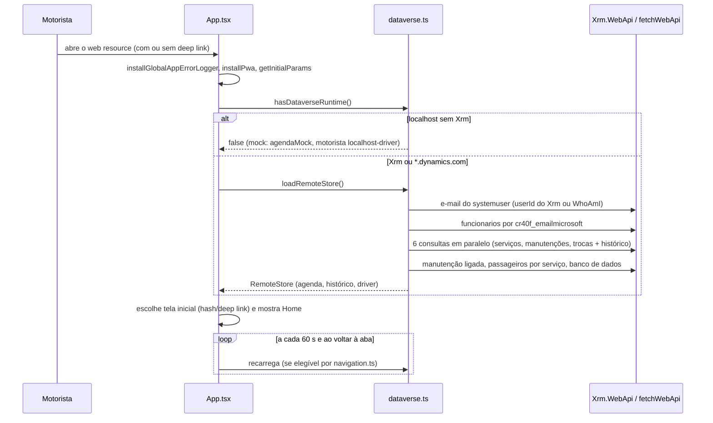
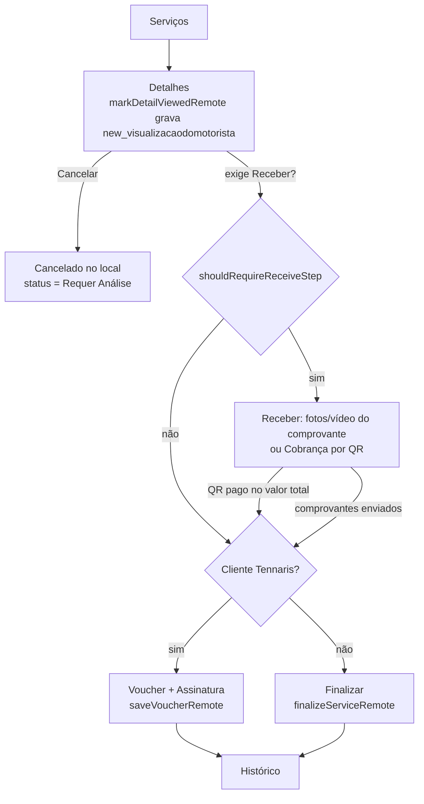
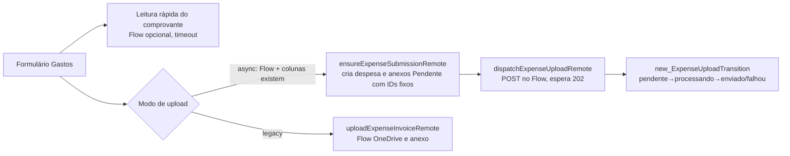

# 04. Fluxos principais

Todos os fluxos abaixo foram reconstruídos pela leitura do código. Execução real contra o Dataverse **não foi feita** (somente leitura de código e testes locais).

## 1. Abertura do app e carga da agenda

Falhas: e-mail ausente, funcionário não encontrado ou duplicado geram erro explícito (`getDriverContext`); não há dados de exemplo fora de `localhost`.

## 2. Serviço: detalhe → receber → (voucher | finalizar)

Detalhes técnicos:

- **Recebimento**: cada foto/vídeo vai pelo Flow de OneDrive (`Recebimentos/<reserva>`), o link volta ao app e uma linha é criada em `cr40f_anexorecebimento_v2` (ver `03`). Comprovantes ficam em memória/IndexedDB até serem enviados; o app só libera finalizar quando todos subiram (`isReceiveStepPending`).
- **Voucher** (`saveVoucherRemote`): valida o carro antes (`buildFinalizeServiceVehiclePatch`); relê `cr40f_status` e `new_linkdovoucher`; se já está concluído com link, não repete. Envia o payload ao Flow de voucher. Em **HTTP 504** não repete o POST: consulta o Dataverse até 21 vezes (3 s entre elas) para ver se o link mudou/ status concluiu. Só então grava `cr40f_status`=concluído e `new_datadefinalizacao`. Rascunho do formulário fica em `new_rascunhovoucher` e em `localStorage` (`app-motoristas-voucher-drafts-v1`).
- **Finalização simples**: um `PATCH` na Geral (status concluído, data, observação mesclada, patch de veículo).
- **Carro do serviço**: `new_origemveiculo` (automático/manual) e `new_ResolverVeiculoDoServico` (Infleet). Quando a Infleet não resolve, o motorista escolhe no `VehicleChoiceDialog`. Se não houver carro, o voucher/finalização falha antes de enviar.
- **Observação**: o texto pode ser organizado por `new_OrganizarObservacao` (IA); sem Dataverse usa mock local. Usada na `FinalizeScreen`; o comportamento da tela quando a API falha **não foi lido em detalhe** (não confirmado).

## 3. Cobrança por QR (Stripe)

1. Habilitada se `cr40f_podecobrarqrcode` (ou localhost).
2. `createQrChargeRemote` → `new_CobrancaQR` com `{acao:"criar", reservaId, valorCentavos, pagante, idioma}`; o plugin revalida permissão, reserva e saldo e cria a sessão Stripe (chave só na configuração segura do step).
3. A tela consulta (`consultar`) ou cancela (`cancelar`) a sessão; `resumo` reidrata total pago, saldo e cobrança aberta após recarregar.
4. Confirmação de pagamento chega por webhook do Stripe → Flow (`scripts/cobranca-qr-webhook-flow.cjs`) que pede ao plugin para espelhar o Stripe (o Flow não valida HMAC; usa só o id da sessão).
5. **Fora de `localhost` nunca há mock** (decisão registrada em memória do projeto, 21/10/2026): sem Xrm a Custom API falha e o motorista vê o erro.
6. Pagamento parcial soma e volta ao Recebimento para foto do restante; total libera finalização/voucher e dispensa comprovante.

## 4. Manutenção e troca de carro

- **Manutenção agendada**: aparece na agenda via Geral (`cr40f_om` → manutenção). Finalizar: salva dados, sobe notas fiscais e fotos finais pelo Flow, grava links e linhas em `new_fotomanutencao`. Exige motorista e veículo para registrar o gasto vinculado (erro explícito se faltar).
- **Troca**: o motorista confirma pela Custom API `new_ConfirmarTrocaMotorista` (envia ETag em `new_VersaoEsperada` para detectar conflito; motivo fora da janela quando aplicável). O app só decide se o participante é motorista 1/2; a regra de fechamento é do servidor (`getExchangeCompletionState` só decide o texto de progresso). Troca "base" (devolução/retirada) tem tratamento próprio em `isBaseExchange` (detalhe não lido).
- **Solicitar manutenção**: cria `cr40f_manutencoes` com veículo atual e solicitante, mais até 3 fotos.

## 5. Gastos (despesas operacionais)

- A decisão async×legacy é por configuração (`resolveExpenseUploadModeRemote`); qualquer falha antes de criar registros cai no legado.
- No modo async o envio é idempotente (`PATCH` com `If-None-Match: *`; se a resposta se perde, o ID fixo é relido) e há fila "Envios pendentes" por motorista em `localStorage` (`expense-upload:<clientUrl>:<motoristaId>`).
- Despesa exige categoria, forma de pagamento e cidade carregadas (`expenses.reference.ts` lança erro se faltarem); regras completas de validação por campo ficam em `normalizeExpenseFields` (não detalhadas aqui).

## 6. Colisão

`colisoesInicio` → `colisoes`: tipo (`eu_bati` | `bateram_em_mim`), data/hora, local, veículo, descrição, dados do terceiro, fotos/vídeo por categoria (cena, danos, CNH, documento, extra). Cria `cr40f_colisao_v2` e anexos (`cr40f_anexocolisao_v2`) com `cr40f_statusanexo` evoluindo (enviando → completo/parcial/falhou). Existe `assertCollisionSchemaReadyRemote` que checa o schema antes de enviar.

## 7. Recibo personalizado

Disponível só se `cr40f_gerarrecibopersonalizado`. `createReceiptRecordRemote` cria o registro (status Gerado), relê `new_id` (identificador automático; erro se faltar), gera o PDF no navegador (`pdf-lib`), sobe pelo Flow (`Recibos/...`), e `sendReceiptEmailRemote` envia ao cliente pelo Flow de e-mail. Falha na preparação marca `cr40f_status_geracao`=Falha e `cr40f_erro`.

## 8. Comunicados, checklist, multas, treinamentos

| Módulo | Fluxo |
|---|---|
| Comunicados | Lista destinatários do motorista (`_new_motorista_value`); abrir marca `new_abertoem` via `new_AbrirComunicadoMotorista`; "ciência" desenha assinatura e chama `new_RegistrarCienciaComunicado`. Push chega por Flow e o toque abre `comunicadoId` via redirect OnLoad |
| Checklist | Itens vêm de `new_itensjson`; tipos `foto`, `numero`, `texto`, `okNok`; máx. 5 fotos por item, 10 problemas por resposta, texto 2000, observação 500. Fotos sobem pelo Flow de OneDrive; conclusão por `new_ConcluirChecklistVeiculo` (o plugin cria as linhas de foto). Rascunho local preserva progresso e fotos já enviadas |
| Multas | Lista termos (`new_status le expirado`) do motorista; assinar exige assinatura + selfie + (opcional) GPS e antes consulta `new_ConsultarAditivoMotorista`; contestar exige motivo; PDF via `new_BaixarPdfTermoMulta`. Sem aditivo → mensagem "procure o escritório". Prazo de assinatura: 7 dias (`PRAZO_ASSINATURA_DIAS`) |
| Treinamentos | Lê treinamentos publicados (`cr40f_estado` publicado) e a participação do funcionário; confirmar leitura ao rolar até o fim, assinatura desenhada, quiz com nota mínima (padrão 70, `NOTA_MINIMA_PADRAO`) e tentativas; grava direto na participação |

## 9. Push (notificações)

O app **não** envia push. Flows (`scripts/provision-*-push-flow*.ps1`, `provision-motorista-push-flows.ps1`) usam o conector Power Apps Notification V2, que só abre tabela/registro; o web resource `new_appmotoristas_push_redirect.js` (OnLoad do form) redireciona para o App com o parâmetro correto (ver `02`). Estado real dos Flows em DEV/PROD: **não confirmado**.

## 10. Erros e telemetria

`reportAppError` (`appErrorLogger.ts`) normaliza, redige e-mails, telefones, base64, URLs de SharePoint/OneDrive/Flow e chaves sensíveis, e grava em `new_appmotoristaslog` pelo pacote `@betinhos-executive-service/ui` (fila local com retry de 30 s). Falhas de plugin ficam no `plugintracelog`; a mensagem ao usuário traz `Ref` = `correlationid`.
