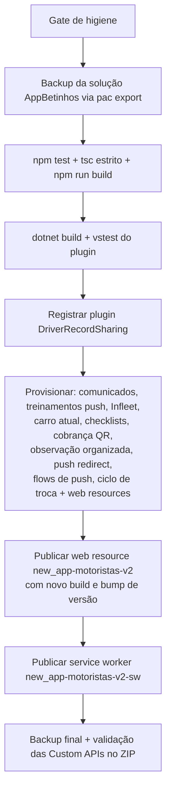

# 06. Como rodar, buildar e publicar

## Pré-requisitos

- Node **24** (o `cloud-setup.sh` instala 24; os testes usam `--experimental-strip-types`, que exige Node ≥ 22.6). Neste levantamento: Node 24.22.2.
- **npm** é o gerenciador oficial (`package-lock.json`, atualizado a cada build). `pnpm-lock.yaml` existe mas está defasado (CLAUDE.md/AGENTS do projeto); não usar pnpm.
- `NODE_AUTH_TOKEN` (token GitHub com `read:packages`) para instalar `@betinhos-executive-service/ui`.
- Para publicar (só Windows): PowerShell, `pac` (Power Platform CLI), módulo `MSAL.PS`, .NET SDK (`dotnet build`/`vstest` para o plugin), acesso de login ao DEV.

## Rodar localmente (modo mock)

```bash
export NODE_AUTH_TOKEN=<token com read:packages>   # nunca versionar
npm ci
PORT=5173 npm run dev       # sem PORT: precisa de reserva em ~/.codex/dev-ports.json
```

Abre `http://127.0.0.1:<porta>/`. Em `localhost` sem Xrm o app entra em **modo mock** (motorista "Localhost", `src/data/mockData.ts`, QR/comunicados/termos/treinamentos simulados). Parâmetros de teste vistos no código: `?mockTerceiro=1` (motorista terceiro, tela "Meu carro"), `mockTermoErro=aditivo|dono` (termos), `mockChecklistFalha` (checklist), `mockApiPort` (comunicados), `mockLeitura`/`mockLeituraValor` (leitura rápida), `mockInfleet` (carro pela Infleet). Pode haver outros (**não confirmado**: busca só em `src/lib`).

Sem `npm run dev`: `npm run build && npm run preview` (porta `PORT` ou 5173).

## Testes e gates

```bash
npm test                                              # 415 testes, 0 falhas neste levantamento
npx tsc --noEmit --noUnusedLocals --noUnusedParameters # gate de tipos do AGENTS.md
npm run build                                         # build de publicação
```

Evidência desta documentação: `npm test` foi executado **sem `node_modules`** (não instalado: sem `NODE_AUTH_TOKEN`) e passou 415/415 em ~6 s, porque os testes importam só código do próprio repositório. `tsc` e `npm run build` **não foram executados** (exigem dependências instaladas); o resultado deles é **não confirmado** nesta branch. Testes .NET do plugin (`dotnet build/vstest`) também **não foram executados** (Windows/.NET Framework 4.6.2).

Atenção ao build: `npm run build` altera `package.json` e `package-lock.json` (PATCH +1) e regrava `dist/`. Em checkout limpo use `node scripts/build-react-singlefile.cjs --no-version` para não mexer em versão.

## Verificação por área (skills do repositório)

`.claude/skills/verificar-index.md` mapeia globs → skill. Exemplos: `verificar-app-geral` (testes, tsc, build, prévia), `verificar-servicos`, `verificar-gastos`, `verificar-formularios`, `verificar-dominio`, `verificar-comunicados`, `verificar-checklists-app`/`-backend`, `verificar-termo-multa`, `verificar-treinamentos`, `verificar-tour`, `verificar-push-redirect`, `verificar-carro-atual-infleet`, `verificar-compartilhamento-motorista`, `verificar-observacao-organizada`, `verificar-ambiente-cloud`. QA de UI em `scripts/qa/*.cjs` (CDP).

## Publicar no DEV (`npm run push`)

Somente a partir de uma `main` atualizada (AGENTS.md). O plugin é um assembly único: publicar de branch atrasada **apaga tipos de plugin de outras frentes** no DEV. Antes de PR, mesclar `origin/main`.

Sequência real de `scripts/push-dev.ps1` (ambiente DEV `org23b93544`, solução `AppBetinhos`):



- O web resource do App vai **por último**: ele pede no `$select` colunas criadas pelos provisionamentos; publicado antes devolveria HTTP 400.
- Flags: `-DeviceCode` (login por código), `-ExpenseUploadOnly`, `-IncludeOperacionais` (inclui a "Tela Funções Operacionais", repositório irmão).
- Pós-push, tenta `Sistema Betinhos/packages/deploy/solucoes/distribuir-apos-push.ps1` (caminho absoluto fixo em `package.json`).
- Todos os scripts de escrita chamam `Assert-DevEnvironment`: fora do DEV falham, salvo `BETINHOS_ALLOW_DIRECT_PROD=1`.

## Publicar no PROD (`scripts/deploy-prod.ps1`)

Regras de `docs/deploy-prod.md` e do cabeçalho do script:

1. PR → `main` → `npm run push` (DEV) → `deploy-prod.ps1 -Apply`.
2. Pré-checagens: `main` limpa e igual a `origin/main`; DEV servindo a versão do `package.json`; no PROD, aviso se steps de plugin estão sem configuração segura (Infleet, link de acompanhamento); depois do import, PROD servindo a mesma versão e nova checagem dos steps.
3. Exporta a solução **gerenciada** do DEV e importa no PROD (stage-and-upgrade, publica, ativa plugins e fluxos).
4. Sem `-Apply` só mostra o plano (dry run). Parâmetros: `-SolutionUniqueName AppBetinhos`, `-AppWebResourceName new_app-motoristas-v2`, `-SkipGitChecks`.
5. Nunca publicar componente direto no PROD: cria camada **Active** que sombreia imports gerenciados (PROD passa a servir versão antiga). Auditoria: `audit-prod-layers.ps1`; correção: `remove-prod-active-layer.ps1 -WebResourceName new_app-motoristas-v2` (mostra, e só remove com `-Apply`, com backup).
6. A solução não carrega configuração segura: reimportar que recria um step deixa o plugin sem token (incidente de 15/10/2026 citado no script). Por isso os `provision-*` com `-ConfigurarChaveSegura`/token precisam rodar depois.

> Esta documentação não executou nenhum desses comandos.

## Sessões cloud do Claude Code

`CLAUDE.md` seção "Ambiente cloud": o hook `SessionStart` (`.claude/hooks/session-start.sh`, só com `CLAUDE_CODE_REMOTE=true`) roda `scripts/cloud-setup.sh` (Node 24, `npm ci`, Chromium, `tsc`, `npm test`). Log em `/tmp/cloud-setup.log`. A VM nunca roda `push`, `deploy:*` nem scripts que escrevam no Dataverse; o app roda em mock.
