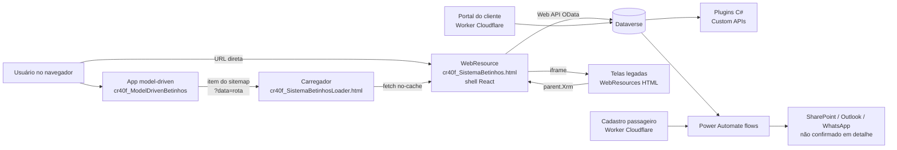
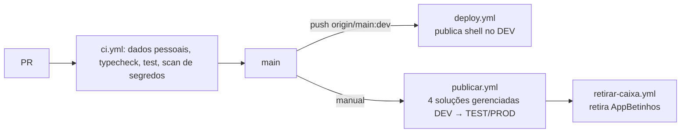

# Visão geral e arquitetura

> Documentação gerada a partir do código do worktree `auto-docs` (base `origin/main`, versão do shell `0.0.129` em `apps/shell/package.json`). Onde não houve evidência no código, está marcado **não confirmado**.

## O que é

Monorepo pnpm (`betinhos-sistema`, `packageManager: pnpm@12.14.0`) do sistema interno da Betinhos Executive Service. O objetivo declarado em `README.md` é substituir o app model-driven do Dynamics 365 / Power Platform por um **shell React único**, publicado como WebResource HTML no Dataverse. O shell reúne menu, rotas por hash e as telas (já migradas para React ou ainda em iframe legado).

## Componentes do monorepo

| Caminho | O que é | Detalhe em |
| --- | --- | --- |
| `apps/shell` | Shell React 19 + Vite 7 + TypeScript; vira `cr40f_SistemaBetinhos.html` (HTML único) | [03](03-mapa-modulos.md), [04](04-contratos-dados-shell.md) |
| `apps/portal-cliente` | Portal do cliente (React) + Worker Cloudflare (`worker/`) | [07](07-apps-satelites.md) |
| `apps/cadastro-passageiro` | Cadastro público do passageiro (Worker Cloudflare) | [07](07-apps-satelites.md) |
| `apps/escala-fds` | App de escala de fim de semana (Vite + schema) | [07](07-apps-satelites.md) |
| `packages/dataverse` | Cliente Web API, metadata, formatação e `Xrm` mínimo (`createClient`, `createMetadata`, `createXrmShim`, `getHostXrm`, `isLocalHost`, `reportingFetch`) | [03](03-mapa-modulos.md) |
| `packages/deploy` | Bump de versão, HTML único, publicação no DEV, soluções, provisionamento de schema, flows | [05](05-ambiente-scripts-deploy.md), [06](06-backend-dataverse.md) |
| `packages/plugins` | Plugins C# (.NET) do Dataverse: Financeiro, Documentos, Frota, Acesso, Cadastro, Portal | [06](06-backend-dataverse.md) |
| `packages/agentes-ia`, `packages/despesas-ia` | Código de IA (agentes por departamento, despesas) | [06](06-backend-dataverse.md) |
| `packages/planner` | Planner (extensão, serverless, Power Platform, WAHA) | [07](07-apps-satelites.md) |
| `legacy/` | Módulos antigos copiados como estão até virarem rotas | [07](07-apps-satelites.md) |
| `scripts/` | Preparo da VM cloud, plantão de erros, varredura de dados pessoais | [05](05-ambiente-scripts-deploy.md), [07](07-apps-satelites.md) |
| `.github/workflows` | `ci.yml`, `deploy.yml`, `publicar.yml`, `retirar-caixa.yml`, `sync-from-dev.yml` | [05](05-ambiente-scripts-deploy.md) |

Design System: `@betinhos/ui` vem do GitHub Packages (alias `npm:@betinhos-executive-service/ui@^1.18.0` no shell); mudanças de componente são feitas no repo `design-system-betinhos`, não aqui (`README.md`, `CLAUDE.md` do diretório pai).

## Arquitetura de execução



Evidências: `apps/shell/src/host.ts` (modo `mock` fora do Dataverse; modo `dataverse` com `createClient(clientUrl)`; instala `window.Xrm` com o Xrm do host ou um shim sobre a Web API para as telas legadas em iframe), `packages/deploy/loader.template.html` (carregador que busca a tela real com `cache: 'no-cache'`), `apps/shell/src/main.tsx` (`applyRouteFromSearch()` converte `?data=<rota>` do sitemap em hash).

## Camadas do shell

```mermaid
flowchart TB
  main[main.tsx<br/>log de erros + perf + rota] --> App[App.tsx<br/>createHost, rótulos de metadata, badges]
  App --> Shell[AppShell<br/>menu lateral]
  Shell --> Route[RouteLayout]
  Route --> Page[Páginas em pages/*<br/>lazy via app/routes.tsx]
  Page --> Data[data/ e domain/ por módulo]
  Data --> DVc[@betinhos/dataverse<br/>client.ts / metadata.ts]
  App --> Err[iniciarCapturaDeErros<br/>grava em cr40f_errodosistema]
```

- **Rotas por hash** (`apps/shell/src/nav/useHashRoute.ts`); menu em `apps/shell/src/nav/menu.ts` com tipos `webresource`, `entity`, `external`, `unavailable` (descritos no `README.md`).
- **Mock**: com `isLocalHost()`, o shell abre sem dados (só navegação e UI). Na VM cloud isso é o único modo possível (`CLAUDE.md`, seção Ambiente cloud).
- **Erros**: `instalarLogDeErros()` e `iniciarCapturaDeErros(host.client)` enviam erros não tratados à tabela `cr40f_errodosistema`, lida pelo plantão (`scripts/plantao`).

## Ambientes e pipeline (resumo)



Regras de publicação estão em `CLAUDE.md` do projeto: `pnpm push` só na `main` do checkout principal; TEST e PROD só pelo workflow `publicar.yml`. Detalhes em [05](05-ambiente-scripts-deploy.md).

## Convenções de dados

- Prefixo atual `cr40f_`; legado `new_` (ex.: Custom APIs `new_GerarLinkCadastro`, `new_*TrocaDeCarro`).
- Valores formatados via `@OData.Community.Display.V1.FormattedValue` (`packages/dataverse/src/format.ts`, função `formatted`).
- Consultas em lote usam `chunk` e `odataString` (`format.ts`).

## Versionamento de build

`packages/deploy/bump-version.mjs` incrementa o PATCH a cada `build` do shell e grava data/hora; a UI exibe `BuildBadge` (`App.tsx`). O build do shell: `bump-version → tsc --noEmit → vite build → inline-webresource` (`apps/shell/package.json`).
