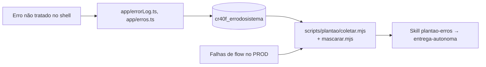
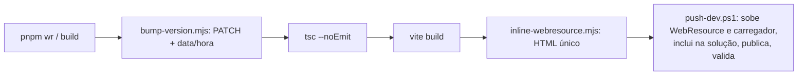

# Fluxos principais

Fluxos descritos a partir de `apps/shell/src/*`, `packages/deploy/*` e `.github/workflows/*`. Detalhes de tabelas e payloads: [04](04-contratos-dados-shell.md) e [06](06-backend-dataverse.md).

## 1. Abertura do shell

```mermaid
sequenceDiagram
  participant N as Navegador
  participant L as Carregador (cr40f_SistemaBetinhosLoader.html)
  participant S as cr40f_SistemaBetinhos.html
  participant D as Dataverse
  N->>L: abre pelo sitemap (?data=rota) ou URL direta
  L->>S: fetch /WebResources/... (cache: no-cache)
  S->>S: main.tsx: applyRouteFromSearch() (?data vira #/rota)
  S->>S: createHost(): mock se localhost; senão createClient(clientUrl)
  S->>S: instala window.Xrm (do host ou shim sobre a Web API)
  S->>D: metadata dos rótulos das tabelas (createMetadata)
  S->>D: badge de documentos urgentes (useDocumentosBadge)
  S->>N: AppShell + RouteLayout + página lazy da rota
```

Fonte: `apps/shell/src/main.tsx`, `host.ts`, `App.tsx`, `packages/deploy/loader.template.html`. Se a leitura de metadata falhar, o menu mostra o nome lógico e o rodapé avisa (`App.tsx`).

## 2. Carga de listas (módulos com visões e filtros)

Os módulos usam `useListView`, `pagedLoad`, `listCache`, `filterRows` e `VirtualTable`/`LazyList` (`apps/shell/src/app/`). Fluxo: a página pede páginas OData via `@betinhos/dataverse`, o cache em memória evita recarga, filtros e ordem vão para a URL (`filtersUrl.ts`, `queryState.ts`) e as visões do usuário são guardadas por `viewStore.ts`. Onde as visões persistem (local ou Dataverse): **não confirmado**; ver `viewStore.ts`.

## 3. Captura de erros e plantão



Evidências: `App.tsx` (`iniciarCapturaDeErros`), `scripts/plantao/`, skills `verificar-plantao` e `plantao-erros`. A coleta usa identidade somente leitura (ver [07](07-apps-satelites.md)).

## 4. Build e publicação do shell no DEV



`pnpm push` faz o mesmo com `push-dev.ps1 -Build` e login MSAL por código de dispositivo (`apps/shell/package.json`). Regras (só `main` no checkout principal, nunca em paralelo, commit do bump) estão no `CLAUDE.md`. Automático no DEV: push de `origin/main` na branch `dev` dispara `deploy.yml`.

## 5. Promoção DEV → TEST → PROD

Workflow manual `publicar.yml` (alvo test ou prod) leva as 4 soluções gerenciadas; depois `retirar-caixa.yml` retira a AppBetinhos. Passos e diagramas em [05](05-ambiente-scripts-deploy.md) §6–7.

## 6. Fluxos de negócio com backend

Cada um tem plugin, flow ou Custom API própria, descritos em [06](06-backend-dataverse.md): link de cadastro do passageiro, termo de multa com assinatura, acesso do motorista ao app, gestão de documentos (resumo semanal), frota proativa (pendências semanais), portal de validação do cliente, lembrete de pagamento, agentes de IA por departamento e despesas com IA. A ordem exata dos passos de cada um está na seção correspondente, não replicada aqui para não divergir.
