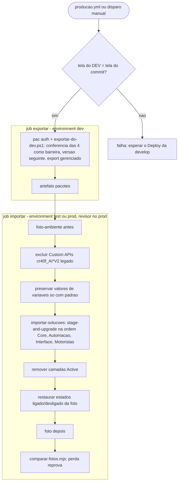
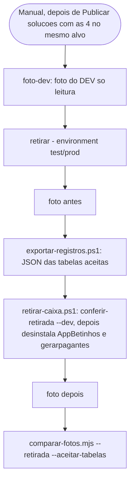

# 05 - Ambiente, scripts e deploy

Documento gerado a partir da leitura do código (worktree `auto-docs`, 03/11/2026). Onde não há evidência no repositório está marcado "não confirmado". Nenhum valor secreto é reproduzido aqui; IDs de conta, KV e URLs assinadas foram omitidos de propósito.

Ambientes citados no código:

| Ambiente | Host | Fonte |
|---|---|---|
| DEV | `org23b93544.crm2.dynamics.com` | `packages/deploy/dv-token.mjs`, `scripts/plantao/coletar.mjs` |
| PROD | `orgf261ae8e.crm2.dynamics.com` | `packages/deploy/rodar-linux.sh` (`DV_BLOCKED_HOSTS`), `scripts/plantao/coletar.mjs` |
| TEST | host não consta no repositório (vem de `vars.DV_ENVIRONMENT_URL` do environment `test` do GitHub) | `.github/workflows/publicar.yml` |

## 1. Visão geral do monorepo

- Gerenciador: `pnpm@12.14.0` (`package.json` raiz, campo `packageManager`), `type: module`, Node 24 (CI e cloud).
- Workspaces: `apps/*` e `packages/*` (`pnpm-workspace.yaml`). `allowBuilds`: `esbuild` e `workerd` liberados, `core-js` não.
- Pacotes do Design System (`@betinhos-executive-service/*`) vêm do GitHub Packages: `.npmrc` aponta o registry; a autenticação fica fora do repo (`~/.npmrc` com token `read:packages`; no CI, `setup-node` + `NODE_AUTH_TOKEN`).
- Pastas sem `package.json` (não são pacotes pnpm, apesar de estarem em `packages/`): `packages/plugins` (solução C# `Cr40f.Financeiro.sln` e projetos `Cr40f.*.Plugin`) e `packages/planner` (código legado do Planner: extension, serverless, power-platform).

## 2. Scripts pnpm por pacote

### 2.1 Raiz (`package.json`)

| Script | O que faz |
|---|---|
| `dev` | `pnpm --filter @betinhos/shell dev` |
| `build` | build do shell (`apps/shell`) |
| `wr` | alias de build do shell (gera o WebResource) |
| `push` | publica o shell no DEV (`push-dev.ps1`); ver seção 5 |
| `sitemap:geral` | insere a SubArea "Geral (novo)" no sitemap `cr40f_ModelDrivenBetinhos` |
| `test` | `pnpm -r test` (todos os pacotes que têm `test`) |
| `typecheck` | só `@betinhos/shell` |
| `push:plugin:{financeiro,documentos,frota,acesso,cadastro,portal}:dev` | roda `packages/plugins/scripts/push-<x>-plugin.ps1` contra o DEV e, em seguida, `distribuir-apos-push.ps1` (se existir) |

### 2.2 Apps

| Pacote | Versão no código | Script | Comando / efeito |
|---|---|---|---|
| `@betinhos/shell` (`apps/shell`) | 0.0.129 | `dev` | `node ../../packages/deploy/dev-restart.mjs 36472 .` |
| | | `typecheck` | `tsc --noEmit` |
| | | `build` | `bump-version.mjs` -> `tsc --noEmit` -> `vite build` -> `inline-webresource.mjs dist --assets-url /WebResources/cr40f_SistemaBetinhos/assets/` |
| | | `wr` | `pnpm build` |
| | | `test` | `vitest run` |
| | | `push` | `push-dev.ps1 -AppDir apps/shell -ResourceName cr40f_SistemaBetinhos.html -DisplayName "Sistema Betinhos" -LoaderName cr40f_SistemaBetinhosLoader.html -DeviceCode -Build` |
| | | `sitemap:geral` | `sitemap-dev.ps1` (SubArea `subarea_geral_novo`, URL do loader com `?data=geral`) |
| `@betinhos/escala-fds` (`apps/escala-fds`) | 0.0.20 | `dev` | `dev-restart.mjs 36481 .` |
| | | `typecheck` / `test` | `tsc --noEmit` / `vitest run` |
| | | `build` | bump -> `tsc` -> `vite build` -> `inline-webresource.mjs dist` (um chunk só) |
| | | `wr` | `pnpm build` |
| | | `schema` | `schema/provision-escala-fds.ps1` (sem `-Apply`: dry run, presumido pelo padrão dos demais scripts; não confirmado neste arquivo) |
| | | `push` | build + `provision-escala-fds.ps1 -Apply -DeviceCode` + `push-dev.ps1` do recurso `cr40f_EscalaFDS.html` |
| `@betinhos/portal-cliente` (`apps/portal-cliente`) | 0.0.0 | `dev` | `dev-restart.mjs 52463 .` |
| | | `typecheck` | `tsc --noEmit && tsc --noEmit -p worker` |
| | | `build` | bump -> `tsc` -> `vite build` (publicação é por Cloudflare Worker; não há script `deploy`/`push` no `package.json`; não confirmado como é publicado) |
| | | `test` | `vitest run` |
| | | `dev:worker` | `vite build && wrangler dev` |
| `@betinhos/cadastro-passageiro` (`apps/cadastro-passageiro`) | 0.0.10 | `dev` | `node scripts/dev-restart.mjs 52418 .` (script próprio do app) |
| | | `push` | `node scripts/bump-version.mjs && wrangler deploy` (Cloudflare Worker) |
| | | `test` | `node --test "test/*.test.mjs"` |
| | | `check` | `node --check` em `src/worker.mjs`, `src/api.mjs`, `public/app.js` |

### 2.3 Pacotes

| Pacote | Script | Efeito |
|---|---|---|
| `@betinhos/dataverse` | `test` | `vitest run` |
| `@betinhos/agentes-ia` | `test`, `typecheck` | `vitest run`, `tsc -p tsconfig.json` |
| | `constantes` | `node scripts/gerar-constantes.ts` (gera `dist/constantes.json`, usado por `provision-agentes-schema.ps1` e pelo flow) |
| | `avaliar` | `node scripts/avaliar.ts` (usa `ANTHROPIC_API_KEY` do ambiente) |
| `@betinhos/despesas-ia` | `test`, `typecheck`, `constantes`, `avaliar` | mesmos nomes e comandos do pacote de agentes |
| `@betinhos/deploy` | `test` | `node --test` em `flows/*.test.mjs` (documentos-resumo-semanal, aniversariantes-diario, cadastro-passageiro-link, portal-cliente-emails) e `solucoes/*.test.mjs` (classificar, conferir, comparar-fotos, conferir-retirada, cli). Os testes `bump-version.test.mjs`, `testa-*.ps1` não entram nesse script |

## 3. Variáveis de ambiente e segredos (somente nomes)

### 3.1 Deploy local e CI do DEV (`.env.example`, `push-dev.ps1`, `solucoes/dataverse.ps1`)

| Variável | Onde é usada | Obrigatória? | Observação |
|---|---|---|---|
| `DV_ENVIRONMENT_URL` | `push-dev.ps1`, `solucoes/*.ps1` | sim | URL do DEV (no CI de publicar, do ambiente de destino). Vem de `vars.` no GitHub |
| `DV_BLOCKED_HOSTS` | `push-dev.ps1` | sim (o script falha sem ela) | hosts de PROD em que o push é proibido |
| `DV_CLIENT_ID` | `push-dev.ps1`, `solucoes/dataverse.ps1`, workflows | sim (GUID válido) | app registration público para login MSAL |
| `DV_TENANT_ID` | idem | só no CI / quando há secret | obrigatória se `DV_CLIENT_SECRET` estiver definido |
| `DV_CLIENT_SECRET` | idem | só no CI (service principal) | secret do environment do GitHub; local fica vazio (login MSAL / device code) |
| `DV_SOLUTION` | `push-dev.ps1` | sim (padrão `AppBetinhos`) | solução não gerenciada que recebe os WebResources |
| `DV_ACCESS_TOKEN`, `FLOW_ACCESS_TOKEN` | `provision-agentes-schema.ps1`, `provision-flow-agentes-executar.ps1`, `rodar-linux.sh` | só fora do Windows | gerados por `dv-token.mjs token <url>`; refresh token em `~/.cache/betinhos-dv/refresh.json` |
| `PUBLISHED_VERSION` | `bump-version.mjs` | interna | `push-dev.ps1 -Build` lê a versão do DEV e exporta só durante o build |
| `ACESSO_TENANT_ID`, `ACESSO_CLIENT_ID`, `ACESSO_LICENSE_SKU_ID`, `ACESSO_GROUP_ID`, `ACESSO_APP_URL`, `ACESSO_ENVIRONMENT_ID` | `push-acesso-plugin.ps1` (configuração não segura do plugin de acesso) | só ao publicar esse plugin | sem segredo; o `clientSecret` do Graph é digitado em `provision-acesso.ps1` |
| `ACESSO_DOMINIO` | idem | opcional | padrão `betinhos.onmicrosoft.com` |
| `CADASTRO_FOTO_FLOW_URL` | `push-cadastro-plugin.ps1` | opcional | URL do flow de leitura de fotos; sem ela mantém a configuração segura já gravada no step |
| `VITE_QUOTES_HYBRID_V`, `VITE_QUOTES_WORKSPACE_V` | `apps/shell/src/pages/planner/constants.ts` | opcionais | chaves de versão das Cotações lidas em build; semântica exata não confirmada |

### 3.2 Cloudflare Workers

| Worker | Segredos/bindings (de `wrangler.jsonc` e do código) | Obrigatório? |
|---|---|---|
| `cadastro-passageiro` | secret `FLOW_URL` (URL do flow HTTP; sem ela, em localhost responde mock); secrets `CONTATO_WHATSAPP`, `CONTATO_EMAIL` (tela de link vencido; sem eles a tela só orienta pedir novo link); `MODO_LOCAL` (lido no código, fora do jsonc); bindings `ASSETS`, KV `CACHE`, rate limit `RATE_LIMITER` (60 req/60 s por IP) | `FLOW_URL` sim em produção; demais opcionais |
| `portal-cliente` | secrets `DV_TENANT`, `DV_CLIENT_ID`, `DV_CLIENT_SECRET`, `DV_URL`, `EMAIL_FLOW_URL`, `CHAVE_TOTP`, `CHAVE_SESSAO`; bindings `ASSETS`, KV `KV` (no arquivo o id está como `TROCAR_PELO_ID_DO_KV`: placeholder a trocar), rate limits `RL_IP` (60/60 s) e `RL_EMAIL` (10/60 s); cron `0 11 * * 1-5` (8h de Brasília, aprovação tácita e resumo diário) | todos os secrets, sim |
| `packages/planner/serverless/triage-worker.js` (legado) | `DEEPSEEK_API_KEY`, `TRIAGE_TOKEN` | não confirmado se ainda está em uso |

Os dois `wrangler.jsonc` têm `account_id` Cloudflare e `workers_dev: true`, `compatibility_date` 2026-09-01. Segredos sobrevivem ao `wrangler deploy` e são definidos com `wrangler secret put <nome>`.

### 3.3 Plantão de erros e cloud

| Variável | Onde | Obrigatória? |
|---|---|---|
| `PLANTAO_TENANT_ID`, `PLANTAO_CLIENT_ID`, `PLANTAO_CLIENT_SECRET` | `scripts/plantao/coletar.mjs` (conta de serviço só leitura no PROD, criada por `criar-identidade-plantao.ps1`) | na nuvem sim; local usa `az account get-access-token` |
| `NODE_AUTH_TOKEN` | `scripts/cloud-setup.sh`, workflows (`secrets.GITHUB_TOKEN`) | sim para instalar `@betinhos-executive-service/*` |
| `CLAUDE_CODE_REMOTE`, `CLAUDE_PROJECT_DIR`, `CLAUDE_ENV_FILE` | `.claude/hooks/session-start.sh`, `cloud-setup.sh` | definidas pelo Claude Code; o hook só age quando `CLAUDE_CODE_REMOTE=true` |
| `ANTHROPIC_API_KEY` | `packages/*-ia/scripts/avaliar.ts` | só para rodar a avaliação |

### 3.4 Segredos e variáveis do GitHub (environments `dev`, `test`, `prod`)

Referenciados pelos workflows: `vars.DV_ENVIRONMENT_URL`, `vars.DV_TENANT_ID`, `vars.DV_CLIENT_ID`, `vars.DV_BLOCKED_HOSTS` (só em deploy.yml), `secrets.DV_CLIENT_SECRET`, `secrets.GITHUB_TOKEN`. Revisor obrigatório no environment `prod` (declarado nos comentários de `publicar.yml`); a configuração do environment no GitHub não é verificável pelo repositório (não confirmado).

### 3.5 Variáveis de ambiente do Dataverse (não são env vars do processo)

`new_URLSistemaBetinhos`, `new_EmailAdminAvisos`, `new_URLFlowRegistrarAvaliacao`, `new_URLFlowConsultarArquivoOneDrive`, `new_FlowURLDespesaLeituraRapida`, `new_AnthropicKey*` (Financeiro, Logistica, Pessoas, Frota, Despesas...). O valor atual de cada uma é de cada ambiente e nunca viaja em solução (`regras.json`, `proibidos["381"]`). `set-variavel-ambiente.ps1` grava o valor de uma variável num ambiente; `solucoes/preservar-valores-variaveis.ps1` protege o valor padrão antes do import.

## 4. Como rodar, buildar e testar

- Instalar: `pnpm install --frozen-lockfile` (precisa de token `read:packages` em `~/.npmrc`).
- Rodar o shell: `pnpm dev` (porta fixa 36472). `dev-restart.mjs` acha o PID na porta (`netstat -ano`), confere se é dev server do projeto, encerra com `taskkill`, espera a porta liberar e sobe o Vite com `--strictPort`; se a porta for de outro serviço, falha com PID e comando. Fora do Windows não encerra nada. Fora do Dataverse (`isLocalHost()`), o shell roda em modo mock.
- Portas reservadas no código: shell 36472, escala-fds 36481, portal-cliente 52463, cadastro-passageiro 52418.
- Build do WebResource: `pnpm wr` (ou `pnpm build`). Passos: `bump-version.mjs` sobe o PATCH no `package.json` do app (base = maior entre a versão do repo e `PUBLISHED_VERSION`) -> `tsc --noEmit` -> `vite build` (embute `__BUILD_DATE__`) -> `inline-webresource.mjs` junta em `dist/webresource.html`. Com `--assets-url`, o CSS vai inline e os chunks JS viram WebResources próprios (lista em `dist/webresource-assets.json`); o chunk de entrada nunca vai inline (evita dois React). No Git Bash, chamar o script direto exige `MSYS_NO_PATHCONV=1`.
- Testes: `pnpm test` (recursivo), `pnpm typecheck` (shell), `pnpm --filter @betinhos/deploy test`. Testes PowerShell: `solucoes/testa-solucoes.ps1`, `solucoes/testa-distribuir-apos-push.ps1`, `testa-chunk-cleanup.ps1`. Testes dos plugins C#: projetos `Cr40f.*.Plugin.Tests` (executor `dotnet test` presumido; não confirmado).
- Verificação por área: skills `.claude/skills/verificar-*` (índice em `.claude/skills/verificar-index.md`, que mapeia caminhos alterados para a skill). 22 skills `verificar-*` mais `plantao-erros`. Sem roteiro ainda: `apps/escala-fds/**`, `packages/despesas-ia/**`.
- Linux/macOS contra o DEV: `node packages/deploy/dv-token.mjs login` (uma vez) e `packages/deploy/rodar-linux.sh <script.ps1> [args]` (exige `pwsh` 7; só DEV, fixa `DV_BLOCKED_HOSTS` no host de PROD).

## 5. Publicação (regras do CLAUDE.md)

1. Decisão de 05/11/2026: `develop` → DEV, `main` → PROD, só pelo GitHub. PRs entram na `develop`; a `main` só recebe a `develop` inteira (merge do Renan).
2. DEV: push na `develop` dispara o workflow "Deploy". Scripts manuais que alteram o DEV (`pnpm push` local, `provision-*`, `push:plugin:*`, `sitemap:*`) só do checkout principal na `develop` atualizada; nunca de feature ou worktree; nunca dois em paralelo.
3. PROD: push na `main` dispara o workflow "Produção" (`producao.yml`), que escolhe o caminho com `caminho-publicacao.mjs` desde a tag `prod-publicado`: só a tela vai direto (`push-front-prod.ps1`); o resto passa por "Publicar soluções" com ensaio no TEST e aprovação no PROD.
4. "Publicar soluções" à mão continua para refazer ensaios; "Retirar AppBetinhos" é manual. Nenhum outro caminho para o PROD.
5. Sessões cloud nunca executam `pnpm push`, `pnpm wr` de publicação, `sitemap:*`, `push:plugin:*` nem `packages/deploy/provision-*`.
6. Merge automático (`.claude/entrega-autonoma.json`, `autoMerge: true`): PR de baixo risco = no máximo 3 arquivos e 80 linhas, sem tocar em `packages/deploy/**`, `packages/plugins/**`, `packages/dataverse/**`, `**/package.json`, `pnpm-lock.yaml`, `.github/**`, `.claude/**`, `scripts/**`, `**/financeiro/**`, `**/pagantes/**`, `**/ops/**`; exige três aprovações no mesmo SHA, verificação registrada e CI verde. Só na `develop` (`base`); nunca na `main`, que publica no PROD.

### O que `push-dev.ps1` faz (`packages/deploy/push-dev.ps1`)

1. Reabre em Windows PowerShell 5.1 se chamado de PowerShell Core.
2. Lê `.env` (variáveis da seção 3.1), exige `DV_BLOCKED_HOSTS` e recusa host bloqueado.
3. Autentica (client secret no CI; senão MSAL/device code).
4. Exige que `DV_SOLUTION` exista, seja única e não gerenciada.
5. Com `-Build`: lê a versão publicada na descrição do WebResource, exporta `PUBLISHED_VERSION` e roda `pnpm build`.
6. Cria ou atualiza o WebResource, o loader (gerado de `loader.template.html`) e os chunks; inclui cada um na solução (tipo 61); guarda versão e commit na descrição do HTML (`vX.Y.Z <sha>`; o commit só entra no CI ou com a árvore limpa).
7. Publica os WebResources, valida pertencimento à solução e remove chunks de builds antigos (`chunk-cleanup.ps1`; mantém o atual e o publicado antes do push).
8. Chama `solucoes/distribuir-apos-push.ps1` (nunca derruba o push; mostra "ATENCAO" se a conferência não zerar).

O loader (`cr40f_SistemaBetinhosLoader.html`) existe porque o model-driven serve WebResources com marcador de cache que nem sempre muda: ele busca a tela real por URL direta com `no-cache`.

## 6. Pipelines

### 6.1 Mapa dos workflows (`.github/workflows`)

| Workflow | Gatilho | Runner | Environment | O que faz |
|---|---|---|---|---|
| `ci.yml` (CI) | `pull_request`, `workflow_call`, `workflow_dispatch` | ubuntu | nenhum | install congelado; `scripts/dados-pessoais.test.mjs` + `scripts/dados-pessoais.mjs` (trava de dado pessoal); `pnpm typecheck`; `pnpm test`; `scan-secrets.mjs solution` |
| `deploy.yml` (Deploy) | push em `develop` (só se mudar `apps/shell/**`, `packages/dataverse/**`, `push-dev.ps1`, `bump-version.mjs`, `inline-webresource.mjs`, `loader.template.html`, `pnpm-lock.yaml`) ou manual | windows | `dev` | instala só `@betinhos/shell...`; `pnpm push`; resumo com a versão. Concorrência `dataverse-dev` (a mesma do export), sem cancelar; 15 min; não repete typecheck/testes |
| `producao.yml` (Produção) | push na `main` ou manual (`caminho`) | ubuntu + windows | `prod-front` (tela) ou via `publicar.yml` | caminho por `caminho-publicacao.mjs`; tela direto ao PROD; resto por `publicar.yml test-e-prod`; move a tag `prod-publicado` |
| `publicar.yml` (Publicar soluções) | `producao.yml` ou manual (`alvo` test/test-e-prod/prod, `solucoes`, `backup`) | windows | `dev` (exportar), `test` e/ou `prod` (`_importar-solucoes.yml`) | ver 6.3 |
| `retirar-caixa.yml` (Retirar AppBetinhos) | manual (`alvo`, `aceitarTabelas`) | windows | `dev` (foto), `test`/`prod` (retirar) | ver 6.4 |
| `sync-from-dev.yml` | manual | ubuntu | `dev` | ver 6.5 |

### 6.2 DEV (`deploy.yml`)

```mermaid
flowchart LR
  PR[PR aprovado e CI verde] --> M[merge na develop]
  M --> D[branch develop]
  M -->|manual: pnpm push no checkout principal| P
  D --> W[workflow Deploy - job dev]
  W --> P[push-dev.ps1 -Build]
  P --> V[bump PATCH sobre a maior versao]
  V --> B[vite build + inline-webresource]
  B --> U[upload WebResource + loader + chunks na AppBetinhos]
  U --> X[limpeza de chunks antigos]
  X --> Z[distribuir-apos-push.ps1: 4 solucoes + conferencia]
```

### 6.3 TEST e PROD (`publicar.yml`)

Job `exportar` (com a trava do commit: a tela do DEV tem de ser a do commit publicado) e um import por alvo (`_importar-solucoes.yml`): `test-e-prod` importa no TEST e, se passar, no PROD com os mesmos pacotes. No PROD o job faz o backup (`pac admin backup`) se o rótulo não vier no input. `ALVO_PS` = `Prod` ou `Test`; no TEST, `--travado` na comparação e `DESLIGAR_NOVOS=true`. Concorrência por alvo (`publicar-<alvo>`, sem cancelar; `retirar-caixa.yml` e o caminho da tela usam o mesmo grupo). O diagrama abaixo é o de um alvo.

Detalhes (de `publicar.yml` e dos scripts em `packages/deploy/solucoes/`):

- `exportar-do-dev.ps1`: conferência das 4 soluções no DEV, sobe a versão e exporta gerenciado. `SOLUCOES` vazio = as 3 do Sistema; a `BetinhosMotoristas` é publicada só pelo `app-motoristas-v2`.
- `excluir-custom-apis-legado.ps1`: guarda JSON de backup e exclui Custom APIs `cr40f_AI*V2` não gerenciadas (travam o upgrade).
- `preservar-valores-variaveis.ps1`: variável que só tem valor padrão no alvo ganha valor atual igual ao padrão (o pacote do DEV substituiria o padrão).
- `importar-solucoes.ps1`: import com `--stage-and-upgrade`, alvo explícito, conexão só aceita o host dele; ordem do manifesto da camada mais baixa para a mais alta.
- `remover-camadas-active.ps1`: tira a camada Active de WebResource, Workflow, step, PluginAssembly, SystemForm, AppModule e SiteMap (hotfixes já estão na main). Pula a `BetinhosMotoristas` e o service worker do app, publicados pelo `app-motoristas-v2`. Roda com `-PermitirProd`.
- `restaurar-estados.ps1`: devolve ligado/desligado de fluxos e steps conforme a foto; no TEST, novos ficam desligados (`-DesligarNovos`).
- Comparação: perda de registros, tabelas, componentes, fluxo ou step que mudou de estado, variável ou configuração segura reprova; informativos: fluxos novos desligados, variáveis sem valor, chunks obsoletos, versões.
- Artefatos: `pacotes` (7 dias); `fotos-<alvo>` (90 dias) com `fotos/`, `pacotes/importados.json`, `camadas-active/`, `custom-apis-legado/`.

### 6.4 Retirada da AppBetinhos (`retirar-caixa.yml`)

- Entrada `aceitarTabelas` (padrão `cr40f_contextooperacionalia`): tabelas que podem sumir com a AppBetinhos; os registros são exportados antes.
- Não faz upgrade da AppBetinhos antes de desinstalar (no TEST de 30/10/2026 o upgrade caiu duas vezes por erro de transporte SQL); a barreira com a foto do DEV prova que o conjunto removido é o esperado.
- Artefato `retirada-<alvo>` (90 dias): `fotos/`, `registros/`, `foto-dev/`.

### 6.5 Sincronização do DEV (`sync-from-dev.yml`)

Manual, só leitura no DEV, checkout da branch `develop`:

1. `pac solution export` da `AppBetinhos` (não gerenciada e gerenciada) e `pac solution unpack` em `solution/AppBetinhos`.
2. Remove `environmentvariablevalues.json` (valor atual é de cada ambiente) e o `defaultvalue` das variáveis com "anthropic" no nome.
3. `scan-secrets.mjs solution` (bloqueia client_secret com valor, Bearer, `sk-`, `sk-ant-`; URL `sig=` e chave Google só avisam; nunca imprime o valor).
4. Se houver diferença, abre branch `sync/dev-<n>` e PR para `develop`.

Nota: o próprio CLAUDE.md informa que o export para TEST/PROD sai direto do DEV (`solucoes.ps1`), então a pasta `solution/` serve como cópia versionada para revisão. O diretório `solution/` não existe nesta worktree (não confirmado se está na `main`).

## 7. As 4 soluções (`packages/deploy/solucoes/regras.json`)

Dependência permitida (quem pode exigir quem): Core não depende de ninguém; Automação -> Core; Interface -> Core, Automação; Motoristas -> Core, Automação.

| Solução | Tipos de componente atribuídos (`porTipo`) |
|---|---|
| `BetinhosCore` | 1 (entidade), 9, 14, 20, 70, 372, 380, 431, 432, `dvtablesearch`, `dvtablesearchentity` |
| `BetinhosAutomacao` | 29 (workflow/flow), 91, 92 (plugin), `customapi` e parâmetros/propriedades, `pluginpackage`, `connectionreference` |
| `BetinhosInterface` | 60, 61 (WebResource), 62, 80 (app), 300, `appaction*`, `appelement`, `appsetting`, `organizationsetting`, `settingdefinition` |
| `BetinhosMotoristas` | `mcpserver` e as exceções do App Motoristas v2 (`new_AppMotoristasv2`, `new_app-motoristas-v2`, etc.) |

Exceções de `regras.json` (resumo): alguns WebResources 61 do Motoristas e do operacional vão para Core ou Motoristas por nome; BPF (tipo 1 `bpf`) vai para Automação; workflows de categoria 2 vão para Core; `dvtablesearch*` seguem o app dono. `proibidos["381"]`: valor de variável de ambiente não viaja em solução. `stepsSeguros` (4 steps que o ambiente pode ter desligado de propósito): sincronizar veículo pela Infleet, gerar link de acompanhamento, revogar link ao sair de Programado, resolver veículo do serviço pela Infleet.

Ferramentas (`packages/deploy/solucoes/`):

| Arquivo | Função |
|---|---|
| `classificar.mjs` | decide a solução de cada componente da caixa de entrada (AppBetinhos no DEV) pelas regras |
| `conferir.mjs` | todo componente em exatamente uma das 4; dependências ausentes; solução Active como base |
| `distribuir-solucoes.ps1` | distribui no DEV (`-Aplicar`) ou só confere (`-SomenteConferir`, exit 1 se fora do lugar) |
| `distribuir-apos-push.ps1` | chamado no fim do push; nunca derruba o push; barra TEST/PROD até zerar |
| `solucoes.ps1`, `dataverse.ps1` | helpers (incluir/remover/criar solução só no DEV; Web API com client credentials no CI ou MSAL) |
| `foto-ambiente.ps1` / `comparar-fotos.mjs` | foto só leitura (registros, fluxos, steps, configuração segura, hash de variáveis, soluções, assemblies, versões) e comparação (`--travado`, `--retirada`) |
| `conferir-retirada.mjs`, `retirar-caixa.ps1`, `exportar-registros.ps1` | barreira, desinstalação e backup JSON da retirada |
| `arquivo.mjs` | leitura de JSON gravado pelo PS 5.1 (BOM) e detecção de execução como CLI |

## 8. Scripts de provisionamento e patches (`packages/deploy`)

Todos os de DEV recusam o host de PROD; os `provision-*` sem `-Apply` rodam em dry run (declarado nos cabeçalhos dos arquivos citados; os demais, não confirmado). Autenticação: `az login`/device code (Windows) ou `DV_ACCESS_TOKEN` (Linux).

### 8.1 Schema (`provision-*` de tabelas, colunas e visões)

| Script | O que faz / o que altera no Dataverse |
|---|---|
| `provision-acesso.ps1` | cria a função de segurança "Acesso - Gestão de Motoristas" e grava a configuração segura (clientSecret do Graph, digitado) nos steps do plugin de acesso |
| `provision-agentes-schema.ps1` | tabelas/choices dos agentes por departamento (`cr40f_agenteexecucao` etc.); choice `cr40f_tipo` vem de `dist/constantes.json` |
| `provision-avaliacao-schema.ps1` | tabela `cr40f_avaliacaoservico` (chave alternativa `cr40f_linkidunico`; choice `cr40f_classificacao`) |
| `provision-despesas-ia-schema.ps1` | colunas da análise por IA em `cr40f_despesaoperacional` (DEV fixo, solução AppBetinhos) |
| `provision-documentos.ps1` | tabelas `cr40f_tipodocumento`, `cr40f_documento`, `cr40f_avisodestinatario`; semeia tipos por `cr40f_codigo` |
| `provision-equipamentos.ps1` | tabelas `cr40f_tipoequipamento`, `cr40f_equipamento`, `cr40f_fotoequipamento`; semeia tipos por nome |
| `provision-erros-schema.ps1` | tabela de erros do sistema (`cr40f_errodosistema`) com Create/Read nível Usuário aos papéis do shell |
| `provision-frota-preventiva.ps1` | colunas de hodômetro em `cr40f_veiculos` e tabelas `cr40f_itemplanopreventivo`, `cr40f_baselinepreventiva` |
| `provision-link-cadastro.ps1` | tabela `cr40f_linkcadastro` (a Custom API `new_GerarLinkCadastro` é criada pelo registrador do plugin, não aqui) |
| `provision-portal-cliente.ps1` | `cr40f_validacaoservico`, `cr40f_validadorcliente`, `cr40f_mensagemvalidacao`, `cr40f_codigoacesso`, `cr40f_dispositivoconfiavel`; campos do portal em `cr40f_clientes1`; migra clientes habilitados para o módulo Validar |
| `provision-termo-multa.ps1` | `new_termomulta`, `new_parcelamultafolha`, `new_textotermomulta`; colunas em `cr40f_multas` e `cr40f_funcionarios`; auditoria; seed dos textos v0 |
| `provision-treinamentos.ps1` | `cr40f_treinamento` e `cr40f_treinamentoparticipacao` |
| `provision-visoes.ps1` | visões salvas das tabelas (Design System 1.6.0, seção 10.9.1) |

### 8.2 Flows (`provision-flow-*`)

| Script | Flow criado/atualizado |
|---|---|
| `provision-flow-agentes-agendado.ps1` | recorrência 07:00 seg a sex (Frota às quartas) que cria execuções Pendente de Financeiro/Pessoas/Frota |
| `provision-flow-agentes-executar.ps1` | "Flow Agentes - Executar": roda ao criar `cr40f_agenteexecucao` Pendente; cria as variáveis `new_AnthropicKey*` se faltarem e ativa o flow |
| `provision-flow-aniversariantes.ps1` | e-mail diário às 08:30 seg a sex (sexta inclui fim de semana); definição em `flows/aniversariantes-diario.json` |
| `provision-flow-avaliacao.ps1` | "Link - Registrar avaliação" HTTP + variável `new_URLFlowRegistrarAvaliacao` |
| `provision-flow-cadastro-passageiro.ps1` | flow HTTP do link de cadastro (fotos no SharePoint); definição `flows/cadastro-passageiro-link.json` |
| `provision-flow-consultar-onedrive.ps1` | flow que lê arquivo por id/link + variável `new_URLFlowConsultarArquivoOneDrive` |
| `provision-flow-despesas-ia.ps1` | flow de análise de despesa quando o comprovante fica Completo |
| `provision-flow-despesas-leitura-rapida.ps1` | flow HTTP de leitura rápida do comprovante + variável `new_FlowURLDespesaLeituraRapida` |
| `provision-flow-documentos-resumo.ps1` | "Documentos - Resumo semanal" + variáveis `new_URLSistemaBetinhos`, `new_EmailAdminAvisos` |
| `provision-flow-frota-resumo.ps1` | "Frota - Resumo semanal" (quarta 08:00); definição `flows/frota-pendencias-semanal.json` |
| `provision-flow-hodometro.ps1` | lê odômetro na Infleet e grava `cr40f_hodometro`/`cr40f_hodometroem` em `cr40f_veiculos`; ao ativar e a cada 6 h |
| `provision-flow-lembrete-pagamento.ps1` | corrige o lembrete de pagamento e o "Gerar Link de Pagamento" (usa `flows/lembrete-pagamento.ps1`) |
| `provision-flow-portal-cliente-emails.ps1` | flow HTTP de e-mails do portal (código, resumo diário, resposta) com remetente fixo; modelos em `flows/portal-cliente-emails/*.html` |
| `provision-flow-resumo-diario.ps1` | e-mail diário 07:00 dos dias úteis com pendências (CNH, ASO, documentos de veículo, multas) |
| `provision-flow-termo-multa.ps1` | dois flows do termo: "Cópia ao motorista" (ligado) e o segundo (não confirmado pelo cabeçalho; ver o script) |

### 8.3 Privilégios (`conceder-privilegios-*`)

| Script | O que faz |
|---|---|
| `conceder-privilegios-documentos.ps1` | copia para as 3 tabelas de documentos os privilégios (e profundidade) que cada papel listado tem em `cr40f_funcionarios` (decisão de 13/10/2026; dado sensível, nunca motoristas/portal) |
| `conceder-privilegios-equipamentos.ps1` | idem para equipamentos; padrão só MDA e "DEV - Usuário" (decisão de 21/10/2026); pode retirar tudo de papéis indicados (ex.: Canvas) |
| `conceder-privilegios-termo-multa.ps1` | privilégios do termo para gestão/escritório e para o papel dos motoristas no App Motoristas v2; membros de perfil de campo opcionais |
| `conceder-privilegios-treinamentos.ps1` | idem equipamentos, para as 2 tabelas de treinamentos |

### 8.4 Patches de flows existentes (`patch-flow-*`) e PROD (`prod/`)

| Script | O que faz |
|---|---|
| `patch-flow-comprovantes-sharepoint.ps1` | troca a gravação no OneDrive do noreply por SharePoint (site BetinhosGestoInterna, pasta `Despesas/<ambiente>/AAAA/MM`) e o link por `CreateSharingLink` |
| `patch-flow-salvar-foto-sharepoint.ps1` | idem para a foto do passageiro (`Passageiros/Fotos/<DEV|PROD>/<id>.<ext>`), sem link de compartilhamento |
| `patch-flow-servico-editado.ps1` | corrige `filteringattributes` do gatilho de "Notificação Serviço Editado" (disparava em qualquer update) e a coluna informada |
| `patch-flow-tenaris-contatos.ps1` | impede que a sincronização Tenaris apague telefone/e-mail/departamento do passageiro (`cr40f_bancodedados`) |
| `prod/_prod.ps1` | helpers comuns dos scripts de PROD (confere a organização antes de gravar; nunca imprime segredo nem `sig=`) |
| `prod/ativar-despesas-ia-prod.ps1` | ativa os dois flows de despesas IA no PROD (`-Desativar` volta a Rascunho); só confere as chaves, não lê valor |
| `prod/patch-flow-comprovantes-pasta-prod.ps1` | troca o segmento `DEV` fixo por `PROD` na pasta do SharePoint após o import gerenciado |
| `prod/patch-flow-lembrete-pagamento-prod.ps1` | aplica a correção do lembrete no PROD, com backup em `flows/backup/PROD-*` |
| `prod/url-leitura-rapida-prod.ps1` | grava o valor atual de `new_FlowURLDespesaLeituraRapida` no PROD fora da solução; nunca imprime a URL |

### 8.5 Outros scripts em `packages/deploy`

| Script | Função |
|---|---|
| `bump-version.mjs` (+ `.test.mjs`) | incrementa o PATCH do `package.json` do app |
| `inline-webresource.mjs` | junta o build em `dist/webresource.html` (e manifesto de chunks) |
| `inject-solution.mjs` | copia o build para a solução desempacotada (WebResource e loader) para TEST/PROD; falha se o componente não estiver na solução versionada. Não aparece em nenhum workflow atual (não confirmado se ainda é usado) |
| `loader.template.html` | modelo do loader do WebResource (`{{RESOURCE}}`, `{{TITLE}}`) |
| `chunk-cleanup.ps1` | apaga chunks com hash de builds antigos |
| `sitemap-dev.ps1` | insere ou atualiza uma SubArea no sitemap de um app model-driven e publica |
| `scan-secrets.mjs` | varredura de segredos da solução desempacotada |
| `set-variavel-ambiente.ps1` | grava o valor atual de uma variável de ambiente (ValidatePattern da URL e do nome) |
| `dev-restart.mjs`, `dv-token.mjs`, `rodar-linux.sh` | porta de dev, token por device code e execução em Linux (seções 3 e 4) |
| `criar-identidade-plantao.ps1` | cria app registration só leitura "Plantao Claude - Leitura" (idempotente; segredo de validade curta, renovar com `-SoRenovarSegredo`) |
| `migrar-documentos.ps1` | migra CNH/ASO da ficha para `cr40f_documento` (um Vigente por funcionário e tipo; idempotente) |
| `migrar-fotos-passageiros-sharepoint.ps1` | move fotos do OneDrive para o SharePoint e grava o link novo em `new_linkdafoto`; não apaga no OneDrive |
| `regravar-links-fotos.ps1` | regrava links `:i:/s/...` como URL com caminho e remove permissões de link `organization` |
| `inspecionar-despesas-ia.ps1` | somente leitura (GET) sobre despesas IA; `-DumpDir` opcional |

Plugins C# (`packages/plugins/scripts/push-*-plugin.ps1`): publicam os assemblies no DEV (financeiro, documentos, frota, acesso, cadastro, portal) e registram steps/Custom APIs pelos registradores `Cr40f.*.Registrar`/`tools` (detalhe não lido em profundidade; não confirmado). Os scripts acessam o DEV e, pelo `package.json` raiz, chamam `distribuir-apos-push.ps1` no fim.

## 9. `scripts/` e `.claude/`

| Caminho | Função |
|---|---|
| `scripts/cloud-setup.sh` | prepara a VM cloud (Linux): Node 24 via nvm, `pnpm` da versão de `packageManager` via corepack, `.npmrc` com `NODE_AUTH_TOKEN`, `pnpm install --frozen-lockfile`, Chromium headless do Playwright (reaproveita o da imagem), checagem rápida; idempotente; falha sem token |
| `scripts/testa-cloud-setup.sh` | teste do setup em Linux limpo (WSL): instalação limpa, 2ª execução, sem token, vazamento de token nos logs |
| `scripts/dados-pessoais.mjs` (+ test) | trava do CI contra CPF válido, e-mail de pessoa e backup de flow versionado (lê `git ls-files`) |
| `scripts/plantao/coletar.mjs` | coleta só leitura: falhas de flow do PROD e erros do app (DEV e PROD) das últimas 24 h (`--desde`), agrupados e mascarados, saída JSON |
| `scripts/plantao/mascarar.mjs` (+ test) | mascara telefone, CPF, e-mail, placa e tokens (mantém GUIDs) |
| `.claude/settings.json` | hook `SessionStart` (`startup|resume`, timeout 600 s) que roda `.claude/hooks/session-start.sh` |
| `.claude/hooks/session-start.sh` | só age com `CLAUDE_CODE_REMOTE=true`; roda `cloud-setup.sh`, log em `/tmp/cloud-setup.log`; não bloqueia a sessão em falha |
| `.claude/entrega-autonoma.json` | política de merge automático (seção 5, item 6) |
| `.claude/skills/verificar-*` e `plantao-erros` | roteiros de verificação por área e plantão de erros; índice em `verificar-index.md` |

## 10. Pontos de atenção encontrados

- `apps/portal-cliente/wrangler.jsonc` mantém `TROCAR_PELO_ID_DO_KV` como id do KV: precisa ser criado e trocado antes do deploy; o `package.json` do app não tem script de deploy (não confirmado como o portal é publicado).
- O script raiz `push:plugin:*:dev` tem caminho absoluto do checkout principal (`C:/Users/mendo/Desktop/vscode/Sistema Betinhos/...`) para chamar `distribuir-apos-push.ps1`; ele não funciona em outra máquina e, em worktree, chama o script do checkout principal.
- `@betinhos/deploy test` não inclui `bump-version.test.mjs` nem os testes de `scripts/` (`dados-pessoais`, `mascarar`); estes rodam só quando chamados direto (o CI roda `dados-pessoais.test.mjs` explicitamente; `mascarar.test.mjs` não aparece no CI: não confirmado).
- `deploy.yml` não roda typecheck nem testes (depende do CI do PR) e não é disparado por mudanças fora da lista de `paths`.
