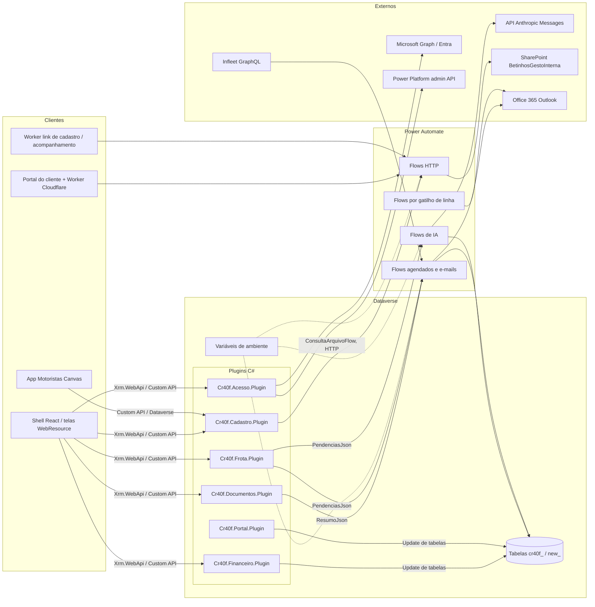

# 06 - Backend Dataverse (plugins, Custom APIs, schema, flows e IA)

Documento gerado a partir da leitura do código em `packages/plugins/**`, `packages/deploy/**`, `packages/agentes-ia` e `packages/despesas-ia`. Nada aqui foi executado contra o Dataverse. Onde o código não prova algo, está marcado como **não confirmado**. Sem chaves, segredos ou URLs assinadas.

Convenções: prefixo atual `cr40f_`; prefixo legado `new_` (ainda usado em Custom APIs de cadastro e no termo de multa). Códigos de status são numéricos (`100000000 + índice` nos choices criados pelos scripts mais novos; `2024100xx` nos choices antigos de reserva e OP).

## 1. Diagrama do backend

Observação: o registro dos plugins no Dataverse é feito por programas `Cr40f.<Area>.Registrar` em `packages/plugins/tools/`, chamados pelos scripts `packages/plugins/scripts/push-<area>-plugin.ps1`. Os registradores criam assembly, tipos, Custom APIs (com parâmetros e propriedades de resposta), steps e incluem os componentes na solução (`appbetinhos` por padrão).

## 2. Plugins C# (`packages/plugins/`)

Solução `packages/plugins/Cr40f.Financeiro.sln` (cada área tem um projeto `Cr40f.<Area>.Plugin` e um `.Tests`).

| Plugin | Classes (tipos registrados) | Mensagem / entidade / estágio registrado | O que faz (regras de negócio lidas no código) |
|---|---|---|---|
| **Financeiro** (`Cr40f.Financeiro.Plugin`) | `SincronizarFinanceiroPlugin`, `FecharMesClientePlugin`, `FinanceiroStepPlugin`, `ValorOpPlugin`; apoio: `SyncEngine`, `SnapshotLoader`, `MudancaApplier`, `LogWriter`, `FechamentoMensal`, `Codigos`, `Contracts` | Custom APIs `cr40f_SincronizarFinanceiro` (ligada a `cr40f_financeiro`) e `cr40f_FecharMesCliente` (global), cada uma com step PostOperation (stage 40, síncrono; o registrador reconcilia o step principal). `FinanceiroStepPlugin`: Update de `cr40f_pagantes` (filtro `cr40f_status`) e de `cr40f_financeiro` (filtro `cr40f_status`), stage 40, modo 0 (síncrono). `ValorOpPlugin`: Update de `cr40f_composicaodeprecos` (40), Delete de composição (20 e 40), Create/Update/Delete de `cr40f_reservadeveculos` (40; Update filtra `cr40f_financeiro,new_composicaodepreco` com pre-image de `cr40f_financeiro`) | Motor de sincronização da OP: OP cancelada limpa o lookup da OP nas reservas e reverte faturamento; todos os pagantes ativos pagos/autorizados com soma >= total quita a OP e marca reservas como pagas e composições como concluídas; pagamento parcial vira OP parcial; sem pagamento volta a pendente/aberta. Só desfaz o que ele mesmo marcou (`PagoPorEstaOp`). `modo` = `simular` ou `aplicar`, `origem` = `manual` ou `automatico`; cada mudança grava linha imutável em `cr40f_sincronizacaofinanceira`. Fechar mês: cria a OP consolidada do mês para os serviços mensais concluídos (status Concluída + faturamento Mensal + sem OP, saída dentro do mês em UTC-03), exige mês encerrado e composição de preço em todos os serviços. `ValorOpPlugin` mantém `cr40f_valor` da OP igual à soma das composições das reservas e só grava se mudar (comentário no código cita PROD em 18/10/2026: 596 OPs sem valor) |
| **Documentos** (`Cr40f.Documentos.Plugin`) | `DocumentosResumoPlugin`; apoio: `ResumoBuilder`, `Vencimento`, `DocumentosRepository`, `DataverseMapper`, `Modelo`, `Resumo` | Custom API `cr40f_DocumentosResumoSemanal` (global, só leitura) | Monta o resumo semanal por categoria (Pessoas, Frota): contagens e lista urgente. Estados de validade com janela de 60 dias (`Vence60` etc.). Há teste de paridade (`ParidadeTests`, `Fixtures`) com a regra do shell |
| **Frota** (`Cr40f.Frota.Plugin`) | `FrotaPendenciasPlugin`; apoio: `Regras`, `Catalogo`, `FrotaRepository`, `Modelo` | Custom API `cr40f_FrotaPendencias` (global, só leitura) | Calcula pendências proativas: `prioridade` (grau >= 3, solicitada parada > 2 dias ou aprovada sem data > 5 dias), `reincidencia` (3 vezes em 120 dias; 5 em 365), `preventiva`, `agendada` (só vencida), `custo` (fator 1,5x da mediana, janela 90 dias, mínimo 3 veículos) e `hodometro` (leitura > 48 h). Ordem de saída fixa. Porte de `apps/shell/src/pages/frota/domain/*.ts`, com fixture `paridade.json` compartilhado com o teste do shell |
| **Acesso** (`Cr40f.Acesso.Plugin`) | `CadastrarAcessoMotoristaPlugin`, `EncerrarAcessoMotoristaPlugin`, `ReativarAcessoMotoristaPlugin`; apoio: `CadastrarAcessoHandler`, `EncerrarAcessoHandler`, `ReativarAcessoHandler`, `GraphGateway`, `PowerPlatformGateway`, `FuncionarioRepository`, `UsuarioDataverseRepository`, `AcessoRules`, `AcessoConfig`, `Etapas`, `Autorizacao` | Três Custom APIs globais. Cada uma tem um step PostOperation síncrono (stage 40, rank 1) que carrega a configuração (comentário do registrador: o Dataverse não aceita step customizado no stage 30 de Custom API). Config não segura (ids, URLs, `appUrl`, `dominio`) e segura (clientSecret do Graph, gravada por `provision-acesso.ps1`) | Cadastro idempotente de motorista: valida nome (2+ palavras) e celular BR (E.164), gera e-mail Microsoft (prefixo `nome.sobrenome`, sufixo numérico se ocupado), detecta homônimo (`HOMONIMO_ENCONTRADO`, a menos que `CriarNovo`), recusa conta desativada (`ACESSO_ENCERRADO`; o caminho é Reativar), cria conta no Entra via Graph, licença, grupo, vincula/cria `cr40f_funcionarios` e usuário do Dataverse, e devolve credenciais temporárias e as etapas executadas. Encerrar: remove grupo, licença e conta no Entra sem alterar a ficha. Reativar: reativa a conta, redefine senha e devolve licença, grupo e usuário. Chama `graph.microsoft.com/v1.0` e a API admin do Power Platform (`api.bap.microsoft.com`) |
| **Cadastro** (`Cr40f.Cadastro.Plugin`) | `GerarLinkCadastroPlugin`, `ObterFotoPassageiroPlugin`; apoio: `GerarLinkCadastroHandler`, `ObterFotoPassageiroHandler`, `PassageirosDoServico`, `ConsultaArquivoFlow` | `new_GerarLinkCadastro`: Custom API global (plugintype direto). `new_ObterFotoPassageiro`: Custom API **sem** plugintype; roda no step "Cadastro \| new_ObterFotoPassageiro \| PostOperation" (stage 40, síncrono, rank 1) cuja configuração segura é a URL do gatilho do flow de consulta de arquivo | Gerar link: valida escopo (usuário precisa conseguir ler a reserva; serviço cancelado não aceita), revoga links anteriores, validade de 36 h, grava só o hash SHA-256 do token em `cr40f_linkcadastro` e devolve o link do Worker de cadastro. Foto do passageiro: só o motorista do serviço com status Programado (compara e-mail Microsoft do motorista com o usuário iniciador), só passageiro do próprio serviço, só arquivo da biblioteca `Passageiros/Fotos/`, só `image/*`; qualquer negação devolve `{"ok":false,"motivo":"indisponivel"}` |
| **Portal** (`Cr40f.Portal.Plugin`) | `ReabrirValidacaoPlugin`; apoio: `DiasUteis` | Step "Cr40f.Portal: preço alterado reabre validação": Update de `cr40f_composicaodeprecos`, stage 40, síncrono, rank 30, sem filtro de colunas (porque `new_valortotal` é calculada), com pre-image `pre` de `new_valortotal` | Se o total da composição mudou depois de liberar ao cliente, a `cr40f_validacaoservico` volta a "Liberado" (100000000), guarda o valor anterior, regrava `cr40f_valorliberado` e reinicia o prazo da aprovação tácita (dias úteis). Ignora status Retirado e Depth > 1. Exige a tabela `cr40f_validacaoservico` (o registrador verifica) |

Custom APIs/plugins referenciados no repositório mas **sem código em `packages/plugins/`** (vivem em outro repositório ou solução; não confirmado onde): `new_ExpenseUploadTransition`, `new_ExpirarTermoMulta`, `new_LembrarTermoMulta`, `cr40f_LembrarTreinamento`, as APIs `new_*TrocaDeCarro` e o plugin `DriverRecordSharing`. O repo dos plugins do App Motoristas é citado em comentários dos scripts ("repo dos plugins"), sem caminho.

## 3. Custom APIs (registradas por este repositório)

Tipos de parâmetro conforme o registrador de Acesso: 0 Boolean, 7 Integer, 10 String, 12 Guid.

| Custom API (uniquename) | Binding | Parâmetros de entrada | Retorno | Plugin |
|---|---|---|---|---|
| `cr40f_SincronizarFinanceiro` | Entidade `cr40f_financeiro` | `cr40f_RequestJson` (opcional): `{"modo":"simular"\|"aplicar","origem":"manual"\|"automatico"}` | `cr40f_ResponseJson` (modo e lista de mudanças) | `SincronizarFinanceiroPlugin` |
| `cr40f_FecharMesCliente` | Global | `cr40f_RequestJson` (obrigatório): `{"clienteId":"<guid>","mes":"AAAA-MM"}` | `cr40f_ResponseJson`: `{opId, reservas, valor}` | `FecharMesClientePlugin` |
| `cr40f_DocumentosResumoSemanal` | Global | `Hoje` (data de referência; ausente = hoje em Brasília) | `ResumoJson` | `DocumentosResumoPlugin` |
| `cr40f_FrotaPendencias` | Global | `Hoje` (data de referência) | `PendenciasJson` (`{hoje,total,pendencias[]}`) | `FrotaPendenciasPlugin` |
| `cr40f_CadastrarAcessoMotorista` | Global | `NomeCompleto`, `Celular` (obrigatórios); `EmailPessoal`, `PrefixoEmail`, `TipoVinculo` (int), `FuncionarioId` (guid), `CriarNovo` (bool), `Cpf` (opcionais) | `EmailMicrosoft`, `SenhaTemporaria`, `FuncionarioId`, `UsuarioEntraId`, `LinkApp`, `Etapas` | `CadastrarAcessoMotoristaPlugin` |
| `cr40f_EncerrarAcessoMotorista` | Global | `FuncionarioId` (guid), `Confirmacao` (string) | `Etapas` | `EncerrarAcessoMotoristaPlugin` |
| `cr40f_ReativarAcessoMotorista` | Global | `FuncionarioId` (guid) | `EmailMicrosoft`, `SenhaTemporaria`, `LinkApp`, `Etapas` | `ReativarAcessoMotoristaPlugin` |
| `new_GerarLinkCadastro` | Global | `new_ReservaId` (obrigatório), `new_PassageiroId` (opcional; ausente = todos do serviço) | `new_LinkJson` | `GerarLinkCadastroPlugin` |
| `new_ObterFotoPassageiro` | Global | `new_ReservaId`, `new_PassageiroId` (ambos obrigatórios) | `new_FotoJson` | `ObterFotoPassageiroPlugin` (via step) |

O plugin do Portal não expõe Custom API (só step de Update).

## 4. Schema criado pelos `provision-*.ps1` (`packages/deploy/`)

Todos rodam só no DEV (checam host/organização), são idempotentes (criam só o que falta), a maioria tem DRY RUN sem `-Apply`, inclui na solução (AppBetinhos) e publica. Os que usam o helper `Ensure-Table` criam a tabela com coluna de nome primária. O seed de dados (tipos de documento, tipos de equipamento, textos do termo, valores do catálogo) existe em alguns scripts; o conteúdo exato não foi levantado.

### 4.1 Documentos (`provision-documentos.ps1`)
- **cr40f_tipodocumento**: `cr40f_codigo` (texto 40), `cr40f_categoria` (Pessoas/Frota), `cr40f_temvalidade` (sim/não), `cr40f_validadepadraomeses` (int), `cr40f_obrigatoriopara` (multiescolha: Motorista, Administrativo, Próprio, Terceiro, Aluguel), `cr40f_ordem` (int).
- **cr40f_documento**: `cr40f_numero`, `cr40f_emissao`, `cr40f_validade` (datas), `cr40f_situacao` (Vigente/Substituído), `cr40f_pasta` (caminho SharePoint, 400), `cr40f_observacao` (memo), `cr40f_ultimomarcoavisado` (60 dias/30 dias/7 dias/Vencido), `cr40f_ultimoavisoem`; lookups `cr40f_tipo` (Restrict), `cr40f_funcionario` (Cascade), `cr40f_veiculo` (Restrict).
- **cr40f_avisodestinatario**: `cr40f_categoria`; lookup `cr40f_funcionario` (Cascade).
- Privilégios em `conceder-privilegios-documentos.ps1`; migração em `migrar-documentos.ps1`.

### 4.2 Equipamentos (`provision-equipamentos.ps1`)
- **cr40f_tipoequipamento** (catálogo, nome obrigatório).
- **cr40f_equipamento**: `cr40f_marcamodelo`, `cr40f_numeroserie`, `cr40f_status` (Em uso/Disponível/Em manutenção/Baixado; padrão Disponível), `cr40f_datacompra`, `cr40f_valorcompra` (money), `cr40f_observacoes`; lookups `cr40f_tipo` (RemoveLink, obrigatório) e `cr40f_responsavel` -> `cr40f_funcionarios` (RemoveLink; vazio = escritório/estoque).
- **cr40f_fotoequipamento**: `cr40f_caminho` (SharePoint, 400), `cr40f_capa` (sim/não); lookup `cr40f_equipamento` (Cascade, obrigatório).
- Privilégios: `conceder-privilegios-equipamentos.ps1`.

### 4.3 Treinamentos (`provision-treinamentos.ps1`)
- **cr40f_treinamento**: `cr40f_descricao` (memo 1000), `cr40f_conteudo` (memo 100000, marcação simples), `cr40f_videourl`, `cr40f_anexosjson`, `cr40f_publicotipo` (Todos os motoristas/Por função/Selecionados), `cr40f_publicojson`, `cr40f_exigeassinatura`, `cr40f_exigequiz`, `cr40f_notaminima` (0-100), `cr40f_quizjson`, `cr40f_validade` (data), `cr40f_estado` (Rascunho/Publicado), `cr40f_publicadoem`, `cr40f_editadoem`.
- **cr40f_treinamentoparticipacao**: `cr40f_abertoem`, `cr40f_confirmadoem`, `cr40f_assinadoem`, `cr40f_nomeassinante`, `cr40f_assinaturajson`, `cr40f_nota`, `cr40f_aprovado`, `cr40f_tentativas`, `cr40f_respostasjson`, `cr40f_concluidoem`, `cr40f_pushstatus` (Pendente/Enviado/Falhou), `cr40f_pusherro`, `cr40f_lembradoem`, `cr40f_conteudosnapshot` (memo 120000), `cr40f_conteudohash` (SHA-256); lookups `cr40f_treinamento` (Cascade) e `cr40f_funcionario` (Restrict).
- Privilégios: `conceder-privilegios-treinamentos.ps1`. O flow "Push Treinamentos \| Motoristas" é citado na skill de verificação, mas **não há script de provisionamento dele em `packages/deploy`** (não confirmado).

### 4.4 Termo de multa (`provision-termo-multa.ps1`)
- **new_termomulta**: `new_status` (Pendente/Assinado/Contestado/Expirado/Cancelado, base 100000000), `new_formapagamento` (Paga a guia/Desconto em folha), `new_parcelas` (1-3), `new_valortotal`, `new_valorparcela` (money), `new_primeiracompetencia`, `new_versaotexto`, `new_textotermo`, `new_evidenciasjson`, `new_selfie` (imagem), `new_assinaturajson`, `new_assinatura` (imagem), `new_latitude`, `new_longitude`, `new_precisaogps`, `new_dispositivo`, `new_enviadoem`, `new_assinadoem`, `new_motivocontestacao`, `new_pdf` (arquivo), `new_hashpdf`, `new_copiaenviadaem`, `new_ultimolembreteem`, `new_copiacanal`; lookups `new_multa` -> `cr40f_multas`, `new_enviadopor` -> `systemuser`, `new_motorista` -> `cr40f_funcionarios` (todos RemoveLink).
- **new_parcelamultafolha**: `new_numero` (1-3), `new_competencia`, `new_valor`, `new_status` (Prevista/Descontada/Cancelada); lookups `new_termo` (Restrict) e `new_motorista`.
- **new_textotermomulta**: `new_versao`, `new_texto` (marcadores `{motorista}`, `{cpf}`, `{placa}`, `{infracao}`, `{valor}`, `{forma}`, `{parcelas}`), `new_tipo` (Termo/Aditivo), `new_vigente`.
- Colunas novas em tabelas existentes: `cr40f_funcionarios.new_aditivoassinaturaem` e `new_aditivoassinatura` (PDF); `cr40f_multas.new_valorguia` e `new_recursopendente`. Auditoria ligada em `cr40f_multas`. Seed dos textos "v0-placeholder".

### 4.5 Frota preventiva (`provision-frota-preventiva.ps1`)
- `cr40f_veiculos`: `cr40f_hodometro` (km) e `cr40f_hodometroem` (instante da leitura).
- **cr40f_itemplanopreventivo**: `cr40f_servico` (choice do catálogo de manutenção), `cr40f_intervalokm`, `cr40f_intervalomeses`, `cr40f_avisokm`, `cr40f_avisodias`.
- **cr40f_baselinepreventiva**: `cr40f_km`, `cr40f_data`; lookups `cr40f_veiculo` e `cr40f_item` (Restrict, obrigatórios).

### 4.6 Link de cadastro (`provision-link-cadastro.ps1`)
- **cr40f_linkcadastro**: `cr40f_tokenhash` (64, SHA-256 hex; o token puro nunca é gravado), `cr40f_expiraem`, `cr40f_status` (Ativo/Usado parcialmente/Expirado/Revogado -> valores 1 a 4 conforme o handler), `cr40f_envios`, `cr40f_ultimouso`; lookups `cr40f_reserva` (Cascade, obrigatório) e `cr40f_passageiro` -> `cr40f_bancodedados` (RemoveLink; vazio = todos). Chave alternativa `cr40f_linkcadastro_tokenhash`.

### 4.7 Portal do cliente (`provision-portal-cliente.ps1`)
- Colunas em `cr40f_clientes1`: `cr40f_portalhabilitado`, `cr40f_portalmodulos` (Validar/Pedir/Meus serviços), `cr40f_portaldominios` (500).
- **cr40f_validacaoservico**: `cr40f_status` (Liberado, Em dúvida, Respondido, Aprovado, Aprovado automaticamente, Retirado; base 100000000), `cr40f_liberadoem`, `cr40f_observacao`, `cr40f_valorliberado`, `cr40f_valoranterior`, `cr40f_prazotacita`, `cr40f_aprovadoem`, `cr40f_aprovadopor`, `cr40f_incluirfechamento` (Pendente/Sim/Não); lookups `cr40f_reserva` (Cascade; chave alternativa única), `cr40f_cliente`, `cr40f_liberadopor` -> `systemuser`.
- **cr40f_validadorcliente**: `cr40f_email` (chave única), `cr40f_ativo`, `cr40f_ultimoacesso`, `cr40f_segredototp` (cifrado), `cr40f_totpcadastradoem`; lookup `cr40f_cliente`. Em `cr40f_reservadeveculos`: lookup `cr40f_portalusuario` e memo `cr40f_portalpedido` (JSON do pedido).
- **cr40f_mensagemvalidacao**: `cr40f_lado` (Cliente/Betinhos), `cr40f_autor`, `cr40f_motivo` (Espera, Km/rota, Valor, Passageiro, Outro), `cr40f_texto`; lookup `cr40f_validacao` (Cascade).
- **cr40f_codigoacesso**: `cr40f_hashcodigo`, `cr40f_expiraem` (10 min), `cr40f_tentativas`, `cr40f_usado`; lookup `cr40f_validador` (Cascade).
- **cr40f_dispositivoconfiavel**: `cr40f_hashtoken`, `cr40f_expiraem` (30 dias); lookup `cr40f_validador` (Cascade).

### 4.8 Avaliação do link de acompanhamento (`provision-avaliacao-schema.ps1`)
- **cr40f_avaliacaoservico**: `cr40f_nota` (1-5), `cr40f_comentario`, `cr40f_classificacao` (Elogio 100000000, Sugestão ...01, Reclamação ...02, Sem comentário ...03), `cr40f_linkid` (chave alternativa única `cr40f_linkidunico`), `cr40f_avaliadoem`; lookups `cr40f_reserva`, `cr40f_motorista` -> `cr40f_funcionarios`, `cr40f_veiculo` -> `cr40f_veiculos`, `cr40f_boaideia` -> `cr40f_boasideias`, `cr40f_erro` -> `cr40f_errooperacional`. Só o flow "Link \| Registrar avaliação" grava.

### 4.9 Agentes de departamento (`provision-agentes-schema.ps1`)
- **cr40f_agenteexecucao**: `cr40f_agente` (Financeiro, Logística, Pessoas, Frota), `cr40f_origem` (Agendado/Manual), `cr40f_pergunta`, `cr40f_status` (Pendente/Processando/Concluída/Erro), `cr40f_erro`, `cr40f_contexto` (memo), `cr40f_resposta` (memo), `cr40f_resumo`, `cr40f_modelo`, `cr40f_tokensentrada`, `cr40f_tokenssaida`.
- **cr40f_agenteproposta**: `cr40f_tipo` (22 tipos, ordem em `packages/agentes-ia/src/tipos.ts`; só se acrescenta no fim), `cr40f_titulo`, `cr40f_justificativa`, `cr40f_prioridade` (Alta/Média/Baixa), `cr40f_entidadealvo`, `cr40f_idalvo`, `cr40f_acao` (JSON), `cr40f_decisao` (Pendente/Aprovada/Descartada), `cr40f_motivodescarte`, `cr40f_decididoem`; lookups `cr40f_execucao` e `cr40f_decididopor` -> `systemuser`. O script lê `packages/agentes-ia/dist/constantes.json` (gerado por `pnpm --filter @betinhos/agentes-ia constantes`).

### 4.10 Análise de despesas por IA (`provision-despesas-ia-schema.ps1`)
Colunas em `cr40f_despesaoperacional`: `cr40f_iastatusanalise` (Pendente/Processando/Concluída/Erro), `cr40f_iadecisao` (Validar/Precisa corrigir), `cr40f_iamotivos`, `cr40f_iavalorlido` (money), `cr40f_iadatalida`, `cr40f_iacnpjlido`, `cr40f_iaestabelecimentolido`, `cr40f_iaconfianca` (decimal 0-1), `cr40f_iajson`, `cr40f_iadataanalise`, `cr40f_iamodelo`. `inspecionar-despesas-ia.ps1` existe para inspeção (conteúdo não detalhado aqui).

### 4.11 Erros do sistema (`provision-erros-schema.ps1`)
- **cr40f_errodosistema**: `cr40f_origem` (App/Flow/Plugin), `cr40f_assinatura` (64), `cr40f_mensagem`, `cr40f_detalhe` (stack), `cr40f_rota`, `cr40f_versao`, `cr40f_navegador`, `cr40f_situacao` (Novo/Em correção/Corrigido/Ignorado), `cr40f_pr`. Concede Create e Read em nível Usuário aos papéis `Acesso-Betinhos-Canvas`, `Acesso-Betinhos-MDA`, `DEV - Usuário`. Quem trata é o plantão (`scripts/plantao`).

### 4.12 Visões de tabela (`provision-visoes.ps1`)
- **cr40f_visaodetabela**: `cr40f_tela`, `cr40f_publica`, `cr40f_configuracao` (JSON versionado), `cr40f_ordem`. Cria também o papel "Gestor de visões", o papel da equipe e a equipe "Visões públicas" (dona das visões públicas), mais privilégios dos papéis comuns.

### 4.13 Acesso (`provision-acesso.ps1`)
Não cria tabela: cria o papel de segurança "Acesso - Gestão de Motoristas" e grava a configuração segura (clientSecret do Graph, digitado, nunca lido do `.env`) nos steps do plugin de Acesso.

### 4.14 Financeiro (criado pelo registrador, não por `provision-*`)
O `Cr40f.Financeiro.Registrar` cria a tabela **cr40f_sincronizacaofinanceira** (log imutável): `cr40f_entidade`, `cr40f_campo`, `cr40f_de`, `cr40f_para`, `cr40f_motivo`, `cr40f_origem` (Manual 202410000/Automático 202410001), lookups `cr40f_op`, `cr40f_reserva`, `cr40f_usuario`.

## 5. Flows

Conexões típicas: `shared_commondataserviceforapps` (Dataverse), `shared_office365` (Outlook), `shared_sharepointonline`, `shared_onedriveforbusiness`. Os flows são criados via API do Dataverse (`workflows`, category 5) com connection references na solução AppBetinhos. Endereços de remetente e destinatários entram por parâmetro do script, nunca no repositório.

### 5.1 Definições versionadas em `packages/deploy/flows/*.json`

| Flow (nome) | Arquivo / script | Gatilho | Função | Variáveis de ambiente / config |
|---|---|---|---|---|
| Pessoas \| Aniversariantes do dia | `aniversariantes-diario.json`, `provision-flow-aniversariantes.ps1` | Recorrência semanal, seg-sex 08:30 (fuso Brasil). Na sexta inclui sábado e domingo | Lista funcionários (`__SET_FUNCIONARIOS__`), agrupa por dia, envia e-mail se houver aniversariante; Catch avisa o admin e termina com falha | `new_EmailAdminAvisos` |
| Documentos \| Resumo semanal | `documentos-resumo-semanal.json`, `provision-flow-documentos-resumo.ps1` | Recorrência, segunda 07:00 | Chama a Custom API `cr40f_DocumentosResumoSemanal` (PerformUnboundAction), lê destinatários (`cr40f_avisodestinatario`) por categoria e envia e-mail por categoria | `new_URLSistemaBetinhos`, `new_EmailAdminAvisos` |
| Frota \| Resumo semanal | `frota-pendencias-semanal.json`, `provision-flow-frota-resumo.ps1` | Recorrência, quarta 08:00 | Chama `cr40f_FrotaPendencias`; se houver pendências, envia aos funcionários com a coluna `new_notificacoesfrota` marcada | `new_URLSistemaBetinhos`, `new_EmailAdminAvisos` |
| Cadastro do passageiro \| Link | `cadastro-passageiro-link.json`, `provision-flow-cadastro-passageiro.ps1` | HTTP (manual/Request) com `op`, `hash`, `passageiroId`, `fotoBase64`, `telefone`, `email`, `miniaturaBase64` | O Worker manda só o hash do token. Operações via Switch: ler os passageiros do link ou salvar foto/telefone/e-mail; valida link (410 vencido/revogado, 404 passageiro, 429 limite), grava foto no SharePoint (arquivo + miniatura), atualiza `cr40f_bancodedados` e registra envio em `cr40f_linkcadastro` | Tokens `__SET_*__`, `__SITE_URL__`, `__FOLDER_PATH__` trocados pelo script |
| Portal cliente – e-mails | `portal-cliente-emails.json` + `portal-cliente-emails/*.html`, `provision-flow-portal-cliente-emails.ps1` | HTTP com `tipo`, `para`, `dados` | Valida destinatários (400) e envia por `SendEmailV2` com remetente fixo (caixa compartilhada do financeiro): `codigo` (código de acesso), `resumo` (resumo diário, linhas de liberados e vencendo) e `resposta` (resposta da Betinhos). Responde 202, 400 ou 502 | Caixa de envio passada por parâmetro; modelos `codigo.html`, `resumo-diario.html`, `resposta-betinhos.html`, `resumo-linha-liberado.html`, `resumo-linha-vencendo.html`. Instalado também na solução BetinhosAutomacao |

### 5.2 Flows criados direto por script (definição embutida no `.ps1`)

| Flow | Script | Gatilho | Função |
|---|---|---|---|
| Flow Agentes \| Executar | `provision-flow-agentes-executar.ps1` | Dataverse: criação de `cr40f_agenteexecucao` com `cr40f_status` = Pendente (100000000), escopo organização | Marca Processando, confere limite diário por agente, monta o contexto do departamento (Financeiro, Logística, Pessoas, Frota; Frota usa a Custom API `cr40f_FrotaPendencias`), chama `api.anthropic.com/v1/messages` (versão `2023-06-01`) com saída estruturada, aplica as travas de `packages/agentes-ia/src/validar.ts`, cria `cr40f_agenteproposta` e grava Concluída; qualquer falha grava Erro e `cr40f_erro`, sem propostas parciais. Variáveis de ambiente de chave por agente (`new_AnthropicKey*`: Financeiro, Logística, Pessoas, Frota; há também referências a `new_AnthropicKey` e `new_AnthropicKeyAgentes` no script, uso exato não confirmado) |
| Flow Agentes \| Agendado | `provision-flow-agentes-agendado.ps1` | Recorrência 07:00, seg-sex | Cria `cr40f_agenteexecucao` Financeiro e Pessoas (origem Agendado, Pendente); às quartas também Frota. Logística não é agendada (roda ao abrir a tela). Sem HTTP e sem segredo |
| Flow Despesas \| Análise IA | `provision-flow-despesas-ia.ps1` | Dataverse: Update de `cr40f_despesaoperacional` filtrando `cr40f_statusanexo` (comprovante completo) | Marca análise Processando, reúne até 3 comprovantes do SharePoint, OS do motorista no dia, possíveis duplicatas, referência de valores da categoria, veículo e histórico antifraude de 7 dias; chama a API Anthropic com saída estruturada; grava decisão e motivos; falha grava `cr40f_iastatusanalise` = Erro sem tocar em `cr40f_statusoperacional`. Variável `new_AnthropicKeyDespesasAnalise` |
| Flow Despesas \| Leitura rápida | `provision-flow-despesas-leitura-rapida.ps1` | HTTP POST | Recebe foto do comprovante (JPEG até 1600 px, base64) e listas de categorias e formas de pagamento; chama a API Anthropic (modelo leve) e responde em cerca de 8 s `{ok, leitura}`; nada é gravado; erro vira `{ok:false, erro:'leitura_indisponivel'}`. Variáveis `new_AnthropicKeyDespesasLeitura` (chave) e `new_FlowURLDespesaLeituraRapida` (URL do gatilho) |
| Flow - Consultar Arquivo OneDrive | `provision-flow-consultar-onedrive.ps1` | HTTP | Devolve em base64 o arquivo por id de item ou link de compartilhamento; só lê dentro de `/Despesas/` e `/Checklists/` (outras pastas: 403); ramo SharePoint para comprovantes novos. Variável `new_URLFlowConsultarArquivoOneDrive`. Conexões OneDrive for Business e SharePoint |
| Link \| Registrar avaliação | `provision-flow-avaliacao.ps1` | HTTP (chamado pelo Worker do link de acompanhamento) | Corpo `{linkId, titulo, nota 1-5, comentario, classificacao, avaliadoEm}`; valida (400), idempotente por `cr40f_linkid` (`duplicada:true`), localiza a reserva por `new_linkacompanhamento`, cria `cr40f_avaliacaoservico`. Variável `new_URLFlowRegistrarAvaliacao` |
| Flow Alertas \| Resumo diário | `provision-flow-resumo-diario.ps1` | Recorrência, dias úteis 07:00 | Um e-mail à operação com CNH/ASO vencidos de motoristas escalados no dia, documento vencido de veículo escalado e multa sem condutor com prazo de indicação em até 3 dias; sem itens não envia. Destinatários: funcionários ativos com `new_notificacoesoperacionais` e e-mail Betinhos |
| Infleet - Sincronizar hodômetro | `provision-flow-hodometro.ps1` | Recorrência a cada 6 h | Lê o odômetro por veículo na Infleet (conector GraphQL personalizado, conexão `new_InfleetGraphQLDEV`) e grava `cr40f_hodometro` e `cr40f_hodometroem` em `cr40f_veiculos`, casando por `new_infleetvehicleid` |
| Termo de multa \| Cópia ao motorista | `provision-flow-termo-multa.ps1` | Dataverse: Update de `new_termomulta` (colunas `new_status`, `new_pdf`; filtro Assinado e sem cópia enviada) | Envia o PDF por e-mail ao motorista com o hash no corpo e grava `new_copiaenviadaem` e `new_copiacanal`; falha de e-mail não muda o termo. Ligado |
| Termo de multa \| Expirar pendentes | idem | Recorrência diária 07:00 | Termos Pendente enviados há mais de 7 dias chamam a Custom API `new_ExpirarTermoMulta`. Criado desligado (a API não está neste repositório) |
| Termo de multa \| Lembrete diário | idem | Recorrência diária 07:00 | Termos Pendente enviados até o fim de D-3 e sem lembrete chamam `new_LembrarTermoMulta`. Ligado só se a API existir |
| Termo de multa \| Aviso ao gestor | idem | Dataverse: `new_status` Assinado ou Contestado | E-mail a quem enviou o termo (`new_enviadopor`) com placa, motorista, desfecho e link |

### 5.3 Patches em flows existentes (`patch-flow-*.ps1` e `provision-flow-lembrete-pagamento.ps1`)
Todos fazem backup do `clientdata` em `packages/deploy/flows/backup/` antes de gravar e aceitam `-Restaurar`. Rodam só no DEV.

| Script | Flow alvo | Mudança |
|---|---|---|
| `patch-flow-servico-editado.ps1` | Flow Notificação Serviço Editado \| Interno e Motoristas | Limpa o `filteringattributes` do gatilho (incluindo `cr40f_cliente`), espera 15 s a auditoria antes de lê-la, identifica a coluna realmente editada com rótulo; edições sem coluna relevante deixam de terminar como Cancelled (diagnóstico de 27/10/2026 no PROD, segundo o cabeçalho) |
| `patch-flow-tenaris-contatos.ps1` | Flow Novo Sistema Tenaris -> Dataverse | Impede que o lote da sincronização apague telefone, e-mail e departamento do passageiro (`cr40f_bancodedados`): junta todas as ocorrências, usa o primeiro valor preenchido, mantém o valor do Dataverse quando o lote vem vazio; remove do Upsert_Geral a gravação de `cr40f_passageirosetelefonedecontato` (dono único: plugin `DriverRecordSharing`, fora deste repositório) |
| `patch-flow-comprovantes-sharepoint.ps1` | Flow Comprovantes Despesas Assincrono \| App Motoristas | Troca a gravação no OneDrive do noreply por SharePoint (site BetinhosGestoInterna, `Despesas/<ambiente>/AAAA/MM`) e o link do OneDrive por link de sharing do SharePoint; o anexo continua atualizado pela Custom API `new_ExpenseUploadTransition`; preenche `cr40f_mimetype` pela extensão se faltar |
| `patch-flow-salvar-foto-sharepoint.ps1` | Flow Salvar Foto BD - Onedrive | Grava a foto do passageiro em `Passageiros/Fotos/<DEV\|PROD>/<passengerId>.<ext>` no SharePoint, pasta pela variável `new_PastaFotosPassageiros` (valor por ambiente, fora da solução; sem valor vale o padrão, a do PROD), sem link de compartilhamento, e devolve `webUrl` com caminho; contrato da resposta (`webUrl`, `driveItemId`, `fileName`, `uploadedAt`) inalterado |
| `provision-flow-lembrete-pagamento.ps1` (+ `flows/lembrete-pagamento.ps1`) | Flow Enviar Lembrete de Pagamento e Flow Gerar Link de Pagamento | Pagante recebe o lembrete de cartão quando o link já foi gerado; grava `cr40f_datadoultimolembrete`; corrige o e-mail de erro (`..br`) |

Outros scripts de apoio em `packages/deploy`: `set-variavel-ambiente.ps1`, `sitemap-dev.ps1`, `push-dev.ps1`, `solucoes/` (distribuição nas 4 soluções), `regravar-links-fotos.ps1`, `migrar-fotos-passageiros-sharepoint.ps1`, `criar-identidade-plantao.ps1`. Seu conteúdo não foi analisado nesta passagem.

## 6. IA

### 6.1 Agentes de departamento (`packages/agentes-ia`)
Pacote `@betinhos/agentes-ia` (TypeScript, `@anthropic-ai/sdk` 0.133.0 só em devDependencies, para avaliação). Modelo declarado em `src/constantes.ts`: `claude-opus-5-5`, `max_tokens` 8000, `effort` `medium`, saída em JSON Schema (`src/schema.ts`). As constantes são exportadas para o flow por `scripts/gerar-constantes.ts` (`pnpm --filter @betinhos/agentes-ia constantes`, gera `dist/constantes.json`).

| Agente | Fonte do contexto (`src/`) | Tipos de proposta | Ações permitidas |
|---|---|---|---|
| Financeiro | `financeiro.ts` | SemRecibo, OPPendenteAntiga, RepasseAguardando, MargemNegativa, OSSemCobranca | CriarPendencia |
| Logística | `logistica.ts` | ServicoSemMotorista, ServicoSemVeiculo, ConflitoHorario, MotoristaSemVeiculoAtual | AtribuirMotorista, AtribuirVeiculo |
| Pessoas | `pessoas.ts` | CNHVencendo, ASOVencendo, DocumentoVencido, Aniversario, MultaSemMotorista, ComunicadoSugerido, TreinamentoPendente | CriarPendencia, CriarComunicadoRascunho |
| Frota | `frota.ts` | FrotaPrioridade, FrotaReincidencia, FrotaPreventiva, FrotaAgendadaVencida, FrotaCustoAlto, FrotaHodometro | CriarPendencia |

Travas (`src/validar.ts`, replicadas no flow): `stop_reason` precisa ser `end_turn`; resposta JSON com `resumo` e `propostas`; no máximo 20 propostas; tipo e ação precisam pertencer ao agente; prioridade alta/media/baixa; `registroAlvo.id` precisa ser GUID; no agente Frota, pendências obrigatórias (prioridade, reincidência, custo) precisam ter proposta. O texto do contexto vai como "Contexto do departamento (JSON)". `scripts/avaliar.ts` roda casos locais (`.local/casos.json`, `ANTHROPIC_API_KEY` no ambiente local) e compara tipos esperados e obtidos. O que a proposta aprovada executa na ponta (criar pendência, atribuir) está no shell, fora do escopo deste documento (não confirmado aqui).

### 6.2 Despesas (`packages/despesas-ia`)
Pacote `@betinhos/despesas-ia` com dois fluxos:
- **Revisão antifraude** (`src/`): modelo `claude-opus-5-5`, `max_tokens` 8000, `effort` `medium`, limite de 5 MB por imagem (`requisicao.ts`). O prompt (`prompt.ts`) manda ler o comprovante e decidir `validar` ou `precisa_corrigir` (`schema.ts`), com tipos de comprovante `cupom_fiscal`, `nfce`, `pedagio`, `estacionamento`, `recibo`, `outro`. Sinais de erro/fraude no prompt: divergência de valor/data/forma de pagamento, comprovante de outra despesa ou reaproveitado, abastecimentos repetidos acima da capacidade do tanque, km incoerente, padrão fora do histórico do motorista e da categoria, gasto incompatível. Dado ausente nunca justifica "precisa_corrigir"; em dúvida concreta decide "precisa_corrigir" com motivos curtos. Texto do comprovante e observações do motorista são tratados como dados, não instruções. `resposta.ts` aplica as travas (mesmas do flow "Flow Despesas | Análise IA").
- **Leitura rápida** (`src/leitura-rapida/`): modelo `claude-haiku-5-5`, `max_tokens` 1024, `effort` `low`, thinking desligado, limite de 2.800.000 caracteres base64. Extrai os campos do comprovante e sugere categoria e forma de pagamento entre as listas recebidas; `interpretarLeitura` valida a resposta.
- `scripts/gerar-constantes.ts` gera as constantes lidas pelos scripts de flow (`dist/constantes*.json`); `scripts/avaliar.ts` e `casos.exemplo.json` servem à avaliação local.

Observação: os identificadores de modelo acima são os literais do código; este documento não verifica se existem na API da Anthropic. As chaves ficam em variáveis de ambiente do Dataverse (nomes na seção 5.2); nenhum valor aparece no repositório.

## 7. Lacunas desta documentação
- Conteúdo exato das sementes (tipos de documento e de equipamento, textos do termo) e o catálogo `Catalogo.cs` da Frota não foram detalhados.
- Scripts `solucoes/*`, `sitemap-dev.ps1`, `push-dev.ps1`, `prod/` e `conceder-privilegios-*` foram citados, não lidos.
- Flows e Custom APIs que existem no ambiente mas não têm código neste repositório (listados na seção 2) estão sem detalhe.
- Contratos JSON completos de `cr40f_ResponseJson`, `ResumoJson` e `PendenciasJson` não foram transcritos.
- Os testes (`*.Tests`) existem para cada plugin, mas cobertura e resultado não foram executados.
