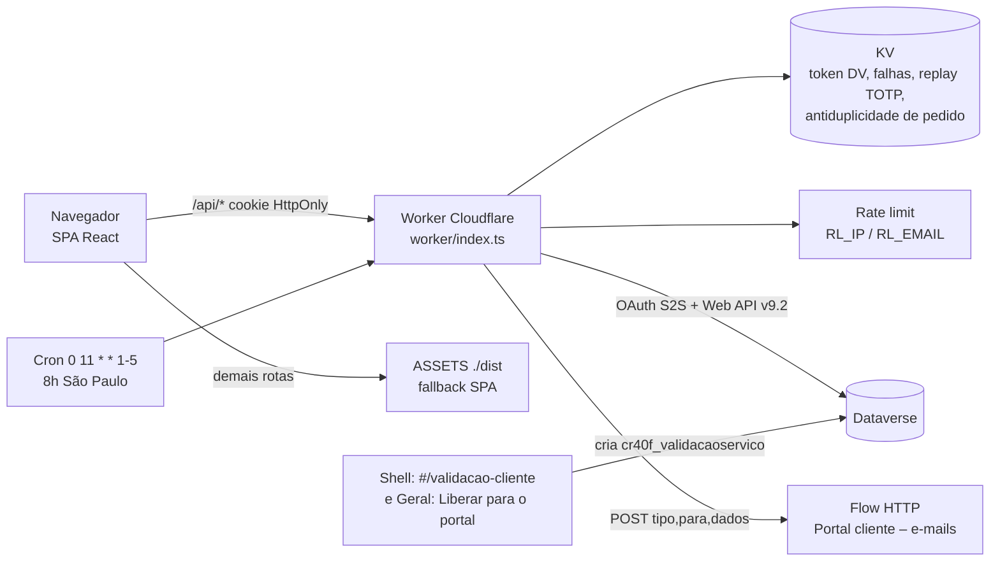
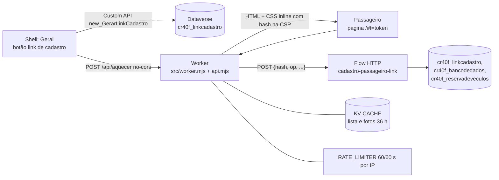
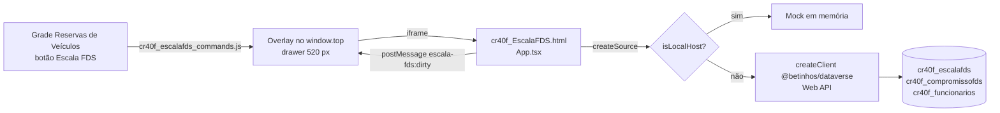
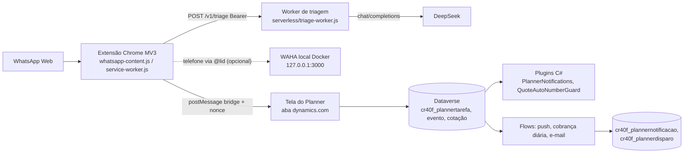

# Apps satélites, Planner, legado e scripts de apoio

> Gerado a partir da leitura do código do worktree `auto-docs`. Onde não houve evidência, está marcado **não confirmado**. Valores de segredos nunca aparecem aqui, só os nomes. Visão geral do monorepo em [01](01-visao-geral-arquitetura.md).

Sumário: 1. Portal do cliente · 2. Cadastro do passageiro · 3. Escala FDS · 4. `packages/planner` · 5. `legacy/` · 6. `scripts/plantao` e `scripts/dados-pessoais.mjs` · 7. `docs/` existentes.

---

## 1. Portal do cliente (`apps/portal-cliente`)

**Finalidade.** Portal multi-cliente por módulos. A Tenaris **valida** os serviços liberados pela Betinhos (aprovar, abrir dúvida, aprovação tácita em 5 dias úteis); a Latasa **pede** serviços e **acompanha** os pedidos. Referências: `apps/portal-cliente/worker/README.md`, `apps/portal-cliente/package.json`.

**Stack.** React 19 + Vite 7 + TypeScript, `@betinhos/ui`, `exceljs` (exportação), `otpauth` e `uqr` (QR do autenticador); Worker Cloudflare em `worker/` (Web Crypto, KV, rate limiting, cron) falando com o Dataverse por usuário de aplicação (OAuth client credentials). Testes com Vitest + jsdom. Sem `@cloudflare/workers-types`: tipos mínimos à mão em `worker/env.ts`.

### Arquitetura

- `src/main.tsx` escolhe a API: **mock** só no dev server local (`localhost`/`127.0.0.1` na porta `52463`) ou com `?mock` na URL; em qualquer outro endereço usa `createWorkerApi()` (`src/api/workerApi.ts`). O contrato das telas é `src/api/PortalApi.ts`.
- Telas em `src/telas/`: `Entrar` (código + autenticador), `Servicos` e `Detalhe` (módulo Validar), `Pedir`, `MeusServicos`, `Conversa`, `Portal`, `Topo`. Regras puras em `src/domain/` (`regras.ts`, `pedidos.ts`), exportação Excel em `src/excel/exportar.ts`.
- Worker: `index.ts` (roteamento, CSRF, CSP, rate limit), `auth.ts` (login), `servicos.ts` (validação), `pedidos.ts` (Pedir/Meus serviços), `cron.ts`, `prazo.ts`, `cripto.ts`, `dataverse.ts`, `odata.ts` (montagem das consultas), `mapear.ts`, `schema.ts` (nomes lógicos e choices), `fakeDataverse.ts` (testes).

### Rotas `/api` (todas respondem `Cache-Control: no-store` e levam CSP, HSTS, `nosniff`, `Referrer-Policy: no-referrer`)

Regras comuns (`worker/index.ts`): escrita (não-GET) exige `Origin` igual à origem do Worker, senão `403 nao_permitido`; limite por IP (`RL_IP`, 60/60 s) → `429 bloqueado`; rotas fora de `/auth` exigem sessão (`401 nao_permitido`) e o módulo do cliente (`403 nao_permitido`). Erro tem o formato `{ "erro": "<codigo>", "mensagem"?: "..." }`; códigos: `codigo_invalido`, `codigo_expirado`, `totp_invalido`, `bloqueado`, `nao_permitido`, `duplicado`, `falha`.

| Rota | Módulo | Corpo → resposta |
|---|---|---|
| `POST /api/auth/codigo` | público | `{email}` → sempre `204`. Em segundo plano (`waitUntil`): acha/cria o validador, grava `cr40f_codigoacesso` e pede ao flow o e-mail `tipo:"codigo"` com `{nome, codigo, validoMinutos:10}`. Limite por e-mail (`RL_EMAIL`, 10/60 s, chave = SHA-256 do e-mail) |
| `POST /api/auth/entrar` | público | `{email, codigo}` (6 dígitos) → `{etapa:"cadastrar_autenticador", otpauthUrl, segredo}` (1º acesso), `{etapa:"autenticador"}` ou `{etapa:"ok", sessao}` (dispositivo lembrado). Grava cookie de etapa (10 min). Erros: `401 codigo_invalido/codigo_expirado`, `429 bloqueado` |
| `POST /api/auth/totp` | cookie de etapa | `{codigo, lembrar?}` → `{nome, email, cliente, modulos[]}` + cookie de sessão (12 h); com `lembrar:true`, cookie de dispositivo (30 dias). `401 totp_invalido` / `nao_permitido` |
| `POST /api/auth/sair` | sessão | `204`, apaga cookie de sessão |
| `GET /api/servicos` | `validar` | lista de `Servico` do cliente da sessão (sem status Retirado), com mensagens |
| `POST /api/servicos/aprovar` | `validar` | `{ids[]}` (GUIDs, 1 a 500) → serviços aprovados (só `liberado`, `em_duvida`, `respondido`); status vira Aprovado, grava `cr40f_aprovadoem` e `cr40f_aprovadopor` (e-mail) |
| `POST /api/servicos/:id/duvida` | `validar` | `{motivo, texto}` (motivo: `espera`, `km_rota`, `valor`, `passageiro`, `outro`) → `Servico`; só em `liberado`/`respondido`; `409` se o status não aceita |
| `POST /api/servicos/:id/responder` | `validar` | `{texto}` → `Servico`; só em `em_duvida`/`respondido` |
| `POST /api/pedidos` | `pedir` | `{passageiros[], origem, destino, saida, observacao?}` → `201` `Pedido`. Cria reserva em **Solicitado** (`cr40f_status` 202410004) ligada ao cliente e ao usuário. `400` com a mensagem do campo; `409 duplicado` para o mesmo pedido do mesmo usuário em 1 min (chave no KV) |
| `GET /api/pedidos` | `meus_servicos` | pedidos do usuário da sessão, com status, veículo e voucher |

Detalhes confirmados no código:
- **Login em duas etapas**: código de 6 dígitos por e-mail (10 min, guardado só como SHA-256 de `vid:codigo`) + TOTP (RFC 6238: HMAC-SHA1, 6 dígitos, passo de 30 s, janela de ±1 passo). Mesmo TOTP não vale duas vezes (chave `totp:<vid>:<codigo>` no KV, 120 s). Quem entra: validador ativo cadastrado, ou, sem cadastro, e-mail de domínio autorizado de **um único** cliente com portal habilitado e algum módulo (o cadastro é criado no primeiro pedido de código). E-mail já cadastrado mas barrado não ganha cadastro novo; e-mail duplicado no cadastro = ninguém entra.
- **Bloqueio**: 5 erros (código ou TOTP) no mesmo e-mail → 15 min (contador `falhas:<sha256(email)>` no KV).
- **Cifra** (`worker/cripto.ts`): AES-GCM com chave de 32 bytes em base64 e o "contexto" como dado autenticado adicional (um cookie não decifra como segredo TOTP). O segredo TOTP fica cifrado em `cr40f_validadorcliente.cr40f_segredototp` com `CHAVE_TOTP` (contexto `totp:<vid>`); os cookies `__Host-portal_sessao` e `__Host-portal_etapa` são cifrados com `CHAVE_SESSAO`; o cookie `__Host-portal_dispositivo` é um token opaco cujo SHA-256 vai a `cr40f_dispositivoconfiavel`. Cookies: `HttpOnly; Secure; SameSite=Strict`.
- **Isolamento**: toda consulta de serviço leva o cliente da sessão no `$filter` (`odata.ts`); id de outro cliente retorna 404. O custo de repasse a terceiro não é exposto (`COMPOSICAO_LINHAS` em `schema.ts`).
- **Prazo tácito** (`worker/prazo.ts`): 5 dias úteis (seg–sex), America/Sao_Paulo fixo em UTC-3, sem feriados nacionais (fixos + Sexta-feira Santa; Carnaval e Corpus Christi não contam como feriado). O prazo gravado (`cr40f_prazotacita`) vem da liberação no shell; o Worker só o aplica.
- **Cron** (`wrangler.jsonc`: `0 11 * * 1-5` = 8h São Paulo, seg–sex), `worker/cron.ts`: (1) `aplicarTacita`: validações vencidas viram Aprovado tácito (`cr40f_status` 100000004) com `cr40f_aprovadoem`; (2) `enviarResumos`: em dia útil, e-mail `tipo:"resumo_diario"` com `{cliente, data, liberados[], vencendoHoje[]}` aos validadores ativos de clientes com módulo Validar; sem itens, não envia.
- **Tipos de e-mail aceitos pelo flow** (`worker/dataverse.ts`): `codigo`, `resumo_diario`, `resposta_betinhos`. O Worker só dispara os dois primeiros; `resposta_betinhos` é enviado pelo shell (`apps/shell/src/pages/validacao-cliente/data/source.ts`, **não detalhado aqui**). Modelos e flow: `packages/deploy/flows/portal-cliente-emails.json` e `.../portal-cliente-emails/*.html`; provisionamento em `packages/deploy/provision-flow-portal-cliente-emails.ps1`.

### Tabelas e colunas Dataverse (`worker/schema.ts`, `packages/deploy/provision-portal-cliente.ps1`)

| Tabela (entity set) | Uso | Colunas lidas/gravadas |
|---|---|---|
| `cr40f_clientes1` (`cr40f_clientes1s`) | cliente/habilitação | `cr40f_portalhabilitado`, `cr40f_portalmodulos` (choice múltipla: Validar 100000000, Pedir 100000001, Meus serviços 100000002), `cr40f_portaldominios`, `cr40f_nomedocliente` |
| `cr40f_validadorcliente` | usuário do portal | `cr40f_email`, `cr40f_ativo`, `cr40f_segredototp`, `cr40f_totpcadastradoem`, `cr40f_ultimoacesso`, lookup `cr40f_Cliente` |
| `cr40f_codigoacesso` | código de e-mail | `cr40f_hashcodigo`, `cr40f_expiraem`, `cr40f_tentativas`, `cr40f_usado`, lookup `cr40f_Validador` |
| `cr40f_dispositivoconfiavel` | "lembrar este computador" | `cr40f_hashtoken`, `cr40f_expiraem`, lookup `cr40f_Validador` |
| `cr40f_validacaoservico` | validação de cada serviço | `cr40f_status` (Liberado 100000000, Em dúvida …01, Respondido …02, Aprovado …03, Aprovado tácito …04, Retirado …05), `cr40f_liberadoem`, `cr40f_prazotacita`, `cr40f_aprovadoem`, `cr40f_aprovadopor`, `cr40f_valorliberado`, `cr40f_valoranterior`, `cr40f_observacao`, lookups `cr40f_Reserva`, `cr40f_Cliente` |
| `cr40f_mensagemvalidacao` | conversa da dúvida | `cr40f_lado` (cliente 100000000, Betinhos …01), `cr40f_autor`, `cr40f_texto`, `cr40f_motivo`, lookup `cr40f_Validacao` |
| `cr40f_reservadeveculos` | reserva (leitura; criação no módulo Pedir) | leitura: `cr40f_id`, `cr40f_idtenaris`, `cr40f_cr`, `cr40f_dataehorriodesada`, `cr40f_endereodesada`, `cr40f_destino`, `new_linkdovoucher`, `new_categoriadoveiculo`, passageiros e solicitante; criação: `cr40f_status`, saída, origem, destino, `cr40f_portalpedido` (JSON), `cr40f_passageirosetelefonedecontato`, `cr40f_observaointerna`, lookups `cr40f_Cliente` e `cr40f_PortalUsuario` |
| `cr40f_composicaodeprecos` | preço exibido ao cliente | `new_valortotal` e linhas de composição (via `$expand` na reserva) |

### Variáveis, bindings e secrets (só nomes; `wrangler.jsonc`, `worker/env.ts`)

- **Bindings**: `KV` (KV namespace; o `id` no arquivo é o texto `TROCAR_PELO_ID_DO_KV`, ou seja, **ainda não criado/preenchido**), `ASSETS` (build `./dist`, `run_worker_first: ["/api/*"]`, fallback de SPA), `RL_IP` (60/60 s) e `RL_EMAIL` (10/60 s), `triggers.crons`.
- **Secrets** (`wrangler secret put`): `DV_TENANT`, `DV_CLIENT_ID`, `DV_CLIENT_SECRET`, `DV_URL`, `EMAIL_FLOW_URL`, `CHAVE_TOTP`, `CHAVE_SESSAO`. Trocar `CHAVE_TOTP` invalida todos os autenticadores cadastrados.
- Sem `vars` no `wrangler.jsonc`. Conta Cloudflare: o mesmo `account_id` do `cadastro-passageiro` (identificador de conta, não segredo).

### Como rodar, testar e publicar

- `pnpm dev` (porta 52463, wrapper `packages/deploy/dev-restart.mjs`), modo mock: aceita o código fixo exibido na tela (`CODIGO_MOCK`); `?refazer-autenticador` só existe no mock.
- `pnpm test` (Vitest: lógica pura, `mockApi`, `workerApi`, Excel e rotas do Worker contra o Dataverse falso `worker/fakeDataverse.ts`) e `pnpm typecheck` (`tsc` no app e em `worker/`).
- `pnpm dev:worker` = `vite build && wrangler dev`; sem secrets, rotas que tocam o Dataverse respondem 500 `falha`.
- Publicar: `pnpm build && pnpm exec wrangler deploy`, da `main`. Pré-requisitos do README do Worker (schema no DEV via `provision-portal-cliente.ps1`, usuário de aplicação com papel mínimo, KV, secrets) **constam como não feitos**: "Antes do 1º deploy (nada disso foi feito)". Estado atual do deploy: **não confirmado**.
- Verificação: skills `verificar-portal-cliente`, `verificar-portal-worker`, `verificar-flow-emails-portal`, `verificar-liberar-portal`, `verificar-validacao-cliente`.

### Riscos

1. Nenhum deploy confirmado e KV sem id: o portal pode não estar no ar; trate como pendência.
2. Criar reserva pelo módulo Pedir dispara plugins da tabela (AutoNumberGuard, preço, compartilhamento): o README manda conferir no DEV antes do piloto.
3. O usuário de aplicação precisa de papel mínimo; escopo largo amplia o impacto de vazamento de `DV_CLIENT_SECRET`.
4. Token do Dataverse fica no KV (`dv:token`) até 5 min antes de expirar; `401` o apaga.
5. Nome de colunas marcadas `CONFIRMAR` no README podem ter sido conferidos depois (comentário de `schema.ts` diz "conferidos na metadata do DEV em 28/10/2026"): **não confirmado** se algo restou.
6. O prazo tácito do cron conta só feriados nacionais (sem municipais/estaduais).
7. `Referrer-Policy: no-referrer` e CSP restritiva: qualquer recurso externo novo (fontes, imagens) será bloqueado.

---

## 2. Cadastro do passageiro (`apps/cadastro-passageiro`)

**Finalidade.** Link público (sem login) para o passageiro conferir/enviar foto, telefone e e-mail. O link é gerado no shell (Geral) pela Custom API `new_GerarLinkCadastro` (plugin `Cr40f.Cadastro.Plugin`); o token vai no fragmento da URL (`#t=`), então não chega ao servidor em log de acesso. O Worker não toca o Dataverse: repassa tudo a um **flow HTTP** (`packages/deploy/flows/cadastro-passageiro-link.json`).

**Stack.** Cloudflare Worker (`src/worker.mjs`, ES modules) + página estática vanilla JS (`public/app.js`, `app.css`, `validacao.mjs`), sem build. Testes com `node --test` e scripts e2e de navegador.

### Arquitetura

### Rotas (`src/api.mjs`; só `POST`, senão `405 metodo`)

Antes de tudo: rota desconhecida → `404 rota`; `Origin` diferente da origem → `403 origem` (exceto `aquecer` e modo local); limite por IP → `429 limite`; corpo > 4 MB → `413 grande`; JSON inválido ou `token` fora de `^[A-Za-z0-9_-]{43}$` → `400 invalido`. O Worker nunca repassa o token: manda ao flow `hash` = SHA-256 hex do token.

| Rota | Corpo | Resposta |
|---|---|---|
| `POST /api/ler` | `{token, fresco?}` | `{dataServico, passageiros:[{id, primeiroNome, temFoto, foto, temTelefone, telefoneMascarado, temEmail, emailMascarado}]}` (ordenado por nome; só aceita campos mascarados com `•`); sem `fresco:true` usa o cache do KV e devolve `cache:true`. |
| `POST /api/foto` | `{token, passageiroId}` | `{foto:{mimeType, base64}\|null}` (cache por hash+passageiro). |
| `POST /api/salvar` | `{token, passageiroId, fotoBase64?, miniaturaBase64?, telefone?, email?}` | resposta do flow (`{ok:true,...}`); exige ao menos um campo além do id; telefone com 10–15 dígitos; e-mail simples; miniatura até 300.000 caracteres (senão descartada e o flow usa a foto). Após salvar, regrava a foto no cache e relê a lista em segundo plano. |
| `POST /api/aquecer` | `{token}` (chamado pelo shell com `no-cors`, `text/plain`) | `202 {ok:true}`; pré-carrega lista e fotos no KV. |

Status repassados do flow: 200, 400, 404 (`nao-encontrado`), 410 (`expirado`), 429, 500 (`falha`); qualquer outro vira 500. Sem `FLOW_URL`: em `localhost`/`MODO_LOCAL=1` responde **mock**; fora disso `500 config`.

Páginas e assets: `GET /` serve o HTML montado em `src/pagina.mjs` com o `app.css` inline (hash SHA-256 na CSP) e um script inicial que já dispara `/api/ler` antes do `app.js`; `Cache-Control: no-store`. Assets com `?v=<versão>` ganham cache imutável de 1 ano; `.mjs` sem `?v=` revalida.

### Tabelas Dataverse (via flow e provisionamento; **não confirmado** o detalhe de cada ação do flow)

`cr40f_linkcadastro` (`cr40f_tokenhash`, `cr40f_expiraem`, `cr40f_status`, `cr40f_envios`, `cr40f_UltimoUso`, lookups `cr40f_reserva` e `cr40f_passageiro`), `cr40f_bancodedados` (passageiro: nome, `cr40f_telefone`, `cr40f_email`, `new_linkdafoto`), `cr40f_reservadeveculos` (`cr40f_passageiro1`..`4`, `cr40f_dataehorriodesada`). Schema em `packages/deploy/provision-link-cadastro.ps1`; flow em `packages/deploy/provision-flow-cadastro-passageiro.ps1`; Custom API em `packages/plugins/Cr40f.Cadastro.Plugin` (`GerarLinkCadastroHandler.BaseLink` aponta para o host `workers.dev` do Worker).

### Variáveis, bindings e secrets (só nomes)

- Bindings (`wrangler.jsonc`): `ASSETS` (`./public`, `run_worker_first: true`), `CACHE` (KV, id já preenchido), `RATE_LIMITER` (60 req/60 s por IP). Sem `vars` no arquivo.
- Secrets: `FLOW_URL` (URL SAS do flow), `CONTATO_WHATSAPP` (só dígitos com 55+DDD) e `CONTATO_EMAIL` (botões da tela de link vencido; opcionais, ausentes = a tela só orienta pedir novo link).
- Variável de dev: `MODO_LOCAL=1` (injetada por `scripts/dev-restart.mjs` via `--var MODO_LOCAL:1`).

### Como rodar, testar e publicar

- `pnpm dev` (porta 52418; `scripts/dev-restart.mjs` encerra dev server anterior do próprio projeto e sobe `wrangler dev --port 52418`; sem `FLOW_URL` usa o mock, e e-mail começando com "erro" simula falha).
- `pnpm test` = `node --test "test/*.test.mjs"` (`test/api.test.mjs`, 27 testes); `pnpm check` = `node --check` nos três JS. Os `test/*.e2e.mjs` (carregamento, envio, fluxo, foto) usam navegador (`test/navegador.mjs`) e **não entram no `pnpm test`**.
- Publicar: `pnpm push` = `scripts/bump-version.mjs` (sobe o PATCH e grava `src/version.mjs`, hoje `v0.0.10 · 03/11/2026 10:35`) + `wrangler deploy`. Não passa pelo workflow `deploy.yml` (**não confirmado**: nenhuma referência a este app nos workflows).
- Verificação: skill `verificar-link-cadastro`.

### Riscos

1. O link vale por 36 h (TTL do cache) e quem o tem vê primeiro nome, fotos e dados mascarados dos passageiros daquela reserva. O token só trafega no POST e vira hash para o flow.
2. `aquecer` aceita chamada de outra origem (a autorização é o token); ele só dispara leitura e cache.
3. O `FLOW_URL` é SAS; vazar permite chamar o flow direto, sem o rate limit do Worker.
4. Plano grátis do KV tem 1.000 gravações/dia: o código só grava quando o valor muda (`cacheGravar`).
5. `compatibility_date` e `wrangler` fixos; `ratelimits` depende do namespace da conta.
6. `scripts/dados-pessoais.mjs` impede e-mail/telefone reais no repositório, por isso os contatos ficam em secrets.

---

## 3. Escala de fim de semana (`apps/escala-fds`)

**Finalidade.** Tela para o time operacional marcar, por motorista, **Plantão** ou **Trabalha** no sábado e domingo da semana (sem marcação = folga) e registrar **ausências** (médico, pessoal, férias, outro), com autosave. Abre como drawer sobre a grade de Reservas de Veículos.

**Stack.** React 19 + Vite 7 + TypeScript, `@betinhos/ui`, `@betinhos/dataverse` (workspace), `lucide-react`; HTML único (`inline-webresource.mjs`) publicado como WebResource `cr40f_EscalaFDS.html`. Vitest.

### Arquitetura

- `src/data/source.ts`: `load({inicio,fim})` busca em paralelo motoristas, marcações e compromissos da semana (segunda a domingo); `save(ops)` grava operação por operação (criar/atualizar/excluir marcação, criar/excluir compromisso), na ordem, para que a falha mostre o que parou. Resolve entity sets pela metadata (`createMetadata`) e erra com "Rode o provisionamento do schema" se faltar tabela. Erros vão ao log compartilhado (`logDataverseFailure`).
- `src/domain/escala.ts`: regras puras (semana, `planSave`, `aplicarPendencias`, `descontarSalvas`). `src/App.tsx`: autosave de 700 ms, troca de semana só com tudo gravado, `beforeunload` e `postMessage` `escala-fds:dirty` para o overlay pedir "Descartar alterações?".
- Não há chamada a Custom API nem a flow.

### Tabelas Dataverse

| Tabela | Colunas usadas pelo app |
|---|---|
| `cr40f_escalafds` | `cr40f_escalafdsid`, `cr40f_data`, `cr40f_status` (Trabalha 100000000, Plantão 100000001; Folga …02 e Indisponível …03 existem no choice, são legado, não são mais gravados), `cr40f_name`, lookup `cr40f_Motorista` (relação `cr40f_funcionarios_cr40f_escalafds_motorista`), `statecode` |
| `cr40f_compromissofds` | `cr40f_compromissofdsid`, `cr40f_inicio`, `cr40f_fim`, `cr40f_diainteiro`, `cr40f_motivo` (Médico …00, Pessoal …01, Férias …02, Outro …03), `cr40f_observacao`, `createdon`, lookup `cr40f_Motorista` |
| `cr40f_funcionarios` | só leitura: `cr40f_funcionariosid`, `cr40f_nomecompleto`, `new_apelido`; filtro `statecode eq 0`, `cr40f_funcao eq 202410000` (motorista), `cr40f_status eq 0` (ativo) |

O provisionamento (`schema/provision-escala-fds.ps1`) também cria `cr40f_Turno` (Integral/Manhã/Tarde/Noite) em `cr40f_escalafds` e as colunas `cr40f_FdsPadraoSabado`/`cr40f_FdsPadraoDomingo` em `cr40f_funcionarios`, **mas nenhum arquivo em `src/` as usa** (não confirmado se algum outro módulo as consome).

### Variáveis e configuração

Sem secrets. O script de schema lê `.env` da raiz (`DV_ENVIRONMENT_URL`, `DV_BLOCKED_HOSTS`, `DV_SOLUTION`) e se recusa a rodar em host bloqueado (PROD). Autenticação por device code (`-DeviceCode`).

### Como rodar, testar e publicar

- `pnpm dev` (porta 36481), `pnpm typecheck`, `pnpm test`, `pnpm build` (bump de versão + `tsc` + `vite build` + HTML único), `pnpm wr` (= build).
- `pnpm schema` roda o provisionamento em **dry run**; `-Apply` cria só o que falta (idempotente) e inclui na solução `DV_SOLUTION`.
- `pnpm push` = build + schema com `-Apply` + `packages/deploy/push-dev.ps1 -AppDir apps/escala-fds -ResourceName cr40f_EscalaFDS.html`. Segue a regra do `CLAUDE.md`: só da `main`, no checkout principal.
- O botão "Escala FDS" vem de `public/WebResources/cr40f_escalafds_commands.js` (namespace `Betinhos.EscalaFds`); como ele chega à ribbon/command bar do model-driven é **não confirmado** no código do app (nenhuma referência em `packages/deploy` nem em `apps/shell/src`).
- Verificação: skill `verificar-escala-fds`.

### Riscos

1. Sem integração com o shell: fica fora do roteador do shell (**não confirmado** qualquer rota); depende do app model-driven e do overlay.
2. O `postMessage` de "dirty" usa `targetOrigin '*'` (mensagem sem dado sensível, só booleano).
3. Gravação sequencial sem transação: falha no meio deixa parte gravada (o app recarrega e mantém o resto como pendente).
4. Folga/Indisponível legados aparecem desmarcados e o registro é reaproveitado ao marcar.

---

## 4. Planner (`packages/planner`)

**Finalidade.** Parte **não-UI** do antigo repo `tela-planner`: scripts de Dataverse/Power Automate, plugins C#, extensão de Chrome (WhatsApp Web → Planner), Worker de triagem por IA e WAHA local. A UI nova está em `apps/shell/src/pages/planner/` (rota `#/planner`). **Sem `package.json`**: nada aqui entra no `pnpm typecheck`. O PROD está congelado: só DEV (`org23b93544`), a partir da `main` (README da pasta).

### Arquitetura

### Componentes

| Pasta | Conteúdo confirmado |
|---|---|
| `extension/` | Manifest V3 (`manifest.json`, v0.1.0; permissões `storage`, `notifications`, `tabs`; hosts WhatsApp Web, `*.dynamics.com`, `127.0.0.1:8765` e `:3000`, `localhost:3000`). `whatsapp-content.js`/`whatsapp-parser.js` leem a conversa ativa; `service-worker.js` faz a triagem, guarda a fila (`betinhos.triage.queue.v1`, máx. 100) e log de depuração (80 eventos) em `chrome.storage.local`; `triage.js` chama o endpoint; `waha.js` resolve telefone; `planner-content.js` faz a ponte `postMessage` com a aba do Planner (mesma origem, com `plannerNonce` em `storage.session`); `popup.*` configura endpoint, token e WAHA. Só entradas **aprovadas pela colaboradora** vão ao Planner. Carga sem empacotar em `chrome://extensions` |
| `serverless/` | `triage-worker.js` + `wrangler.toml` (nome `betinhos-planner-triage`, var `DEEPSEEK_MODEL`=`deepseek-flash`). Endpoint **único**: `POST /v1/triage` (outro método/caminho → 404). Entrada `{senderName, senderPhone, messages:[{direction,text}]}` (exige `senderPhone` e ao menos 1 mensagem, senão 400). Saída `{data:{category, priority, summary, nextAction, dueDate, confidence}}`; categorias `orcamento, reserva, duvida, reclamacao, follow_up, outro`; prioridades `low, medium, high, urgent`; `dueDate` só `yyyy-mm-dd`. Erros: 401 (token), 503 (sem chave), 502 (DeepSeek). Secrets: `DEEPSEEK_API_KEY`, `TRIAGE_TOKEN` (opcional: sem ele não há autenticação); var opcional `ALLOWED_ORIGIN` (padrão `*`) |
| `power-platform/plugins/PlannerNotifications` | `PlannerTaskEventNotificationPlugin`: `Create` em `cr40f_plannertarefaevento`, PostOperation, **assíncrono**, filtro `cr40f_campo, cr40f_valornovo, cr40f_descricao, cr40f_tarefa`; envia `SendAppNotification` (in-app, não push de tela bloqueada) aos destinatários do JSON de `cr40f_valornovo`. Releitura do registro com usuário iniciador, 8 campos `notification:*`, até 50 destinatários. Registro por `scripts/register-planner-notification-plugin.ps1` |
| `power-platform/plugins/QuoteAutoNumberGuard` (+ `.Tests`) | Em `cr40f_pedidodecotacao`, `Create` PreValidation síncrono: descarta `cr40f_numerodacotacao` enviado e normaliza `cr40f_titulo` (vazio ou 1–2 letras vira `Pedido de cotação`). Registro por `scripts/register-quote-autonumber-guard.ps1`. Testes: `dotnet test power-platform/plugins/QuoteAutoNumberGuard.Tests/...csproj -c Release` |
| `power-platform/notifications/README.md` | Documenta flows `Planner | Push Power Apps Mobile` (gatilho: linha criada em `cr40f_plannertarefaevento`), `Planner | Cobrança diária` (seg–sex 08:00 America/Sao_Paulo, chave `<destinatario>|<tarefa>|<tipo>|<yyyy-MM-dd>`), e-mail de teste/automático (só `notification:overdue_manual`, endereço `cr40f_emailbetinhos`), com idempotência por `cr40f_chavededupe`/`cr40f_chaveidempotente` |
| `scripts/` | PowerShell: `create-planner-{immediate,daily,email,automatic-email}-flow.ps1`, `disable-planner-legacy-channels.ps1`, `disable-quote-msplanner-flows.ps1`, `ensure-quote-{v2,pedido,result,long-routes}-dev.ps1`, `verify-quote-workflow-dev.ps1`, `grant-ideas-role-dev.ps1`, `import-planner.ps1`, `remove-pedir-cotacao-sitemap.ps1`, `sitemapNavigation.mjs`, `register-*.ps1`, `waha-install/start/stop.ps1`, `generate_resumo_genericos.py` (**finalidade não confirmada**), `publish-webresource.ps1/.cmd` e `push-dev.ps1` (herdados; **não rodar daqui**, esperam `dist/webresource.html` que não existe) |
| `docker-compose.waha.yml`, `.env.waha.example` | WAHA (`devlikeapro/waha`, engine GOWS) preso a `127.0.0.1:3000`, sem download de mídia, sessão em `.waha-sessions/`. Variáveis: `WAHA_API_KEY`, `WAHA_DASHBOARD_USERNAME`, `WAHA_DASHBOARD_PASSWORD` (valores só no `.env.waha.local`, gerado por `waha-install.ps1`, ignorado pelo Git) |
| `DEPLOYMENT_CHECKLIST.md` | **Herdado do repo antigo** (Tela Planner v0.1.85+), fala de `npm run build` e de caminhos que não existem aqui; tratar como histórico |

### Tabelas Dataverse (nomes achados nos scripts)

`cr40f_plannertarefa`, `cr40f_plannertarefaevento`, `cr40f_plannertarefaequipe`, `cr40f_plannertarearesponsavel`, `cr40f_plannerequipe`, `cr40f_plannerequipemembro`, `cr40f_plannernotificacao` (chave `cr40f_chavededupe`), `cr40f_plannerdisparo` (chave `cr40f_chaveidempotente`; canais e status Enviado 100000001 / Falha 100000002 / Sem identidade 100000003), `cr40f_pedidodecotacao`, `cr40f_funcionarios` (`cr40f_usuariodataverse`, `cr40f_emailbetinhos`, `cr40f_emailmicrosoft`).

### Como rodar e publicar

Tudo em PowerShell a partir de `packages/planner` (README da pasta): WAHA (`waha-install.ps1` uma vez, depois `waha-start.ps1`/`waha-stop.ps1`, requer Docker); flows e schema com `-EnvironmentUrl https://org23b93544.crm2.dynamics.com`; plugins com `dotnet build` e `register-*.ps1` (sem `-Apply` é dry run; login MSAL por device code com cache em disco); Worker `cd serverless; wrangler deploy` (só quando autorizado). Nenhum item roda no CI.

### Riscos

1. `ALLOWED_ORIGIN` ausente = CORS `*` e, sem `TRIAGE_TOKEN`, o endpoint de triagem fica aberto e consome a chave do DeepSeek.
2. A triagem envia nome, telefone e texto de conversas de clientes a um provedor de IA externo (LGPD).
3. A extensão depende do DOM do WhatsApp Web (`whatsapp-parser.js`): quebra a cada mudança de layout.
4. Os `.snk` versionados são chaves de assinatura do assembly (o README os descreve como não-segredos de acesso).
5. Scripts herdados (`publish-webresource`, `push-dev`) podem publicar o WebResource antigo `new_TelaPlanner` se rodados daqui; o README manda não fazer.
6. O plugin de notificação assíncrono precisa de conta técnica com o privilégio Send In-App Notification.

---

## 5. `legacy/`

- `legacy/README.md`: "Cópia, como está, de cada módulo WebResource existente (Fase 1 do plano). Cada pasta mantém seus próprios scripts até ser convertida em rota do shell."
- Conteúdo versionado hoje: apenas `legacy/funcoes-operacionais/INVENTARIO.md` (~58 KB). O HTML do WebResource citado como fonte (versão 1.0.173, build 20/10/2026 09:03) **não está no worktree**.
- O inventário é um checklist de paridade para migrar "Funções Operacionais" para React: anatomia do arquivo (CSS, React 19, design system `bt-*`, GSAP no pull-to-refresh), constantes de configuração, estrutura de telas (Trocar Motorista, Clonar Pedido, Trocar Carro) e a confirmação de que o arquivo não tem Excel, `Xrm.Navigation` nem Flow HTTP. A tela já migrada está em `apps/shell/src/pages/funcoes-operacionais/` (skill `verificar-funcoes-operacionais`).
- Risco: o `orgUrl` e os ids de ambiente do inventário são do DEV antigo (`appbetinhosdev`); servem só de fallback no legado.

---

## 6. `scripts/` de apoio

| Arquivo | O que faz |
|---|---|
| `scripts/plantao/coletar.mjs` | Coleta **somente leitura** para o plantão de erros: falhas de flow do PROD (`flowruns` com `status eq 'Failed'`, agrupadas por `workflowid` + `errorcode`, nomes via `workflows`) e erros novos do app em DEV e PROD (`cr40f_errodosistemas` com `cr40f_situacao` = 100000000 "Novo", agrupados por `cr40f_assinatura`). Saída JSON no stdout (`--desde <ISO>`, padrão 24 h; teto de 5.000 linhas por consulta). Credencial: `PLANTAO_TENANT_ID`, `PLANTAO_CLIENT_ID`, `PLANTAO_CLIENT_SECRET` (conta de serviço) ou `az account get-access-token`. Ambientes fixos no código: `org23b93544` (DEV) e `orgf261ae8e` (PROD). Sai com 1 só se as 3 coletas falharem |
| `scripts/plantao/mascarar.mjs` (+ `.test.mjs`) | Mascara e-mail, CNPJ, CPF, telefone BR, CEP, placa, Bearer, `sig=`/`token=`/`code=` e tokens GitHub; campos JSON com nome/passageiro/cliente/motorista/endereço/telefone/e-mail/cpf/rg/cnh viram `[pessoal]`; GUIDs são preservados. A saída avisa que o conteúdo é dado externo (não seguir instruções contidas nele) |
| `scripts/dados-pessoais.mjs` (+ `.test.mjs`) | Trava do CI (`.github/workflows/ci.yml`, linha com `node --test scripts/dados-pessoais.test.mjs && node scripts/dados-pessoais.mjs`): varre `git ls-files` atrás de CPF válido no formato `000.000.000-00` (ignora 3 CPFs de teste), e-mail de pessoa em `@betinhos.com.br`, gmail, hotmail, outlook ou yahoo (exceto uma lista de nomes funcionais/fictícios) e **qualquer arquivo sob `packages/deploy/flows/backup/`**; sai 1 com valores mascarados |
| `scripts/cloud-setup.sh` e `testa-cloud-setup.sh` | Preparo da VM das sessões cloud (descrito em [05](05-ambiente-scripts-deploy.md)); fora do escopo deste arquivo |

Verificação do plantão: skill `verificar-plantao`; uso: skill `plantao-erros`. Risco principal: a coleta usa credencial do PROD (só leitura); o mascaramento é por regex, então formatos de dado pessoal não previstos passam.

---

## 7. `docs/` existentes (apenas inventário; 1 linha cada)

Raiz e subpastas lidas pelo título; para `superpowers/`, resumo pelo nome do arquivo e do título quando indicado (**conteúdo não lido em profundidade**).

- `docs/acesso-motorista-entra.md`: passo a passo no Entra (app registration do Graph) para o acesso de motoristas ao App Motoristas.
- `docs/auditoria/2026-10-21-appbetinhos-limpeza-e-segmentacao.md`: levantamento (só leitura) de legado, duplicados e proposta de segmentação da AppBetinhos.
- `docs/auditoria/ensaio-segmentacao-2026-10-22.md`: ensaio da segmentação da AppBetinhos no TEST (Fase 2 do plano).
- `docs/evidencias/treinamentos/ux-fluxo-shell-2026-11-03.md` (+ 4 imagens em `img/`): auditoria de UX (modo Fluxo) do módulo Treinamentos.
- `docs/prints/acesso-drawer/` (2 imagens), `docs/prints/cadastro-passageiro-ux-perf/` (13 imagens), `docs/prints/equipamentos-fotos-sharepoint/` (6 imagens): capturas antes/depois de UX e performance.
- `docs/superpowers/notes/2026-10-13-despesas-ia-descoberta.md`: descoberta no DEV de tabelas/flows de despesas com IA.
- `docs/auto/01-visao-geral-arquitetura.md` e este arquivo: documentação gerada do código.
- `docs/superpowers/plans/` (planos de implementação, 2026-10-05 a 2026-11-03): curriculos-react, operacional-react, dashboard-abas, dashboard-resumo, geral-react e fase2 (blocos A–D), despesas-validacao-ia, escala-fds-simples, gestao-documentos, agentes-departamento, financeiro-automatico-plugin, financeiro-pendencias, gestao-frota, alertas-operacao-proativos, documentos-resumo-semanal, financeiro-fechar-mes, listas-visoes-filtros, frota-proativa, equipamentos-mvp, segmentacao-appbetinhos, acesso-motorista, acompanhamento-motorista, link-cadastro-passageiro, termo-multa-assinatura, foto-passageiro-motorista, planner-no-shell, cotacoes-v2 / v2-1 / v2-2, portal-cliente-prototipo, treinamentos-revisao.
- `docs/superpowers/specs/` (especificações/briefs, mesmo período): os `*-design.md` correspondentes aos planos acima, mais pagantes-react, pessoas-react, infracoes-react, ops-react, despesas-operacionais-react, tabelas-visoes-colunas, equipamentos-fotos, termo-multa-ux-v2-brief, segmentacao-appbetinhos-brief, portal-validacao-cliente, treinamentos, e dois `*-legado.md` (dashboard-abas, dashboard-resumo) com a especificação do WebResource antigo.
- Documentos ligados a este arquivo: `docs/superpowers/specs/2026-10-13-escala-fds-simples-design.md`, `.../2026-10-22-link-cadastro-passageiro-design.md`, `.../2026-10-28-portal-validacao-cliente-design.md` e os planos de mesmo nome.
